# Unidad 3 – Capa de Aplicación (DNS, DHCP y Proxy)

> Apunte basado en las diapositivas del Ing. Néstor Pereyra. Tres bloques: **DNS**, **DHCP** y **Proxy de aplicación**.
> Las diapositivas de ejemplo que son imágenes (archivos de zona, named.conf, captura DHCP, seguimiento de conexión) se reconstruyen acá a partir de lo que el texto describe.

---

## 1. La capa de aplicación

La capa de aplicación contiene los protocolos que usan las aplicaciones para aprovechar la red. Definen:

- qué **mensajes** se intercambian,
- qué **significan**,
- en qué **orden** se envían,
- qué **acciones** se hacen al enviarlos o recibirlos.

Para transportar esos mensajes usan **TCP o UDP**. Ejemplos: DNS, DHCP, FTP, TFTP, HTTP.

==Idea clave: la capa de aplicación define el "idioma" entre aplicaciones; el transporte (TCP/UDP) lo lleva.==

---

# PARTE A – DNS

## 2. ¿Por qué DNS?

Las IP identifican interfaces, pero para las personas son difíciles de recordar, **pueden cambiar** y no dicen qué recurso representan. Se usan **nombres legibles** independientes de la IP:

`campusvirtual.uap.edu.ar → 200.45.249.234`

==Idea clave: DNS (Domain Name System) es un sistema **jerárquico y distribuido** que asocia nombres con información de red. Lo más usado: nombre → IP, pero guarda más tipos de datos (registros de recursos).==

**Del esquema plano al jerárquico:** al principio los nombres estaban en una lista central. Al crecer la red: la lista se hacía enorme, se duplicaban nombres, no escalaba la administración central y cada cambio debía propagarse a todos. Por eso se pasó a un esquema **jerárquico y distribuido**.

## 3. El espacio de nombres

DNS es un **árbol**:

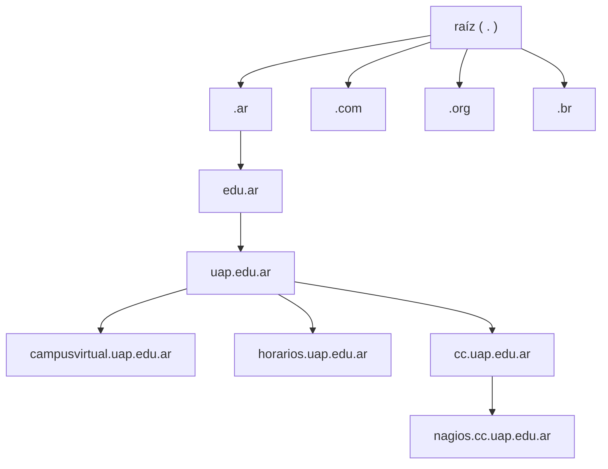

- Arriba está la **raíz** (`.`), debajo los **TLD** (dominios de nivel superior).
- Cada nodo tiene una **etiqueta (label)**.
- El nombre completo se arma concatenando etiquetas **desde el nodo hasta la raíz**, separadas por puntos: `campusvirtual.uap.edu.ar.`
- El **punto final** representa explícitamente la raíz.
- **FQDN** (Fully Qualified Domain Name) / nombre absoluto: ubicación completa y sin ambigüedad desde el nodo hasta la raíz.

### 3.1 Tipos de TLD

| Tipo | Qué agrupa | Ejemplos |
|---|---|---|
| **gTLD** (genéricos) | Por finalidad / tipo de organización | `.com` comerciales, `.org` organizaciones, `.net` servicios de red, `.edu` educativas, `.gov` gobierno, `.int` organismos internacionales |
| **ccTLD** (geográficos) | Países/territorios, 2 letras (ISO 3166-1 alpha-2) | `.ar` Argentina, `.br` Brasil, `.uy` Uruguay, `.es` España, `.fr` Francia |

### 3.2 Dominios, subdominios, delegación y zonas

- **Dominio** = un **subárbol** del espacio de nombres. Su nombre es el del nodo donde empieza (ej. `uap.edu.ar`).
- Todo subdominio es un dominio; "subdominio" se dice al verlo respecto de su padre.
- Un dominio **no es necesariamente un host**: un nombre puede ser un dominio, un host o ambos según los registros que tenga.
- **Delegación:** una organización administra un dominio y **delega** un subdominio a otra organización/servidor. Se transfiere la **autoridad administrativa**.
- **Zona DNS:** porción del espacio de nombres administrada por una **misma autoridad**.

==Idea clave: **dominio** = parte de la jerarquía (el "qué"); **zona** = quién la administra (el "quién"). Ej.: `uap.edu.ar` es un subdominio de `edu.ar` delegado a la UAP; su zona la administran los DNS autoritativos de la UAP, distintos de los de `edu.ar`.==

## 4. Tipos de servidores DNS

Un servidor es **autoritativo** para una zona si tiene la información oficial y puede responder sobre sus registros. Puede haber varios autoritativos (disponibilidad y redundancia).

| Servidor | Qué hace |
|---|---|
| **Primario (master)** | Tiene la **copia principal** de la zona (de sus archivos locales). Normalmente es donde se hacen las modificaciones |
| **Secundario (slave)** | Tiene una copia y la **actualiza desde otro autoritativo** mediante **transferencia de zona** |
| **Caching-only** | **No es autoritativo** de ninguna zona. Resuelve consultando a otros DNS y **guarda en caché** las respuestas |

- Primario y secundario **son ambos autoritativos**.
- Un mismo servidor puede ser primario de una zona y secundario de otra.
- **Transferencia de zona:** proceso por el cual el secundario obtiene/actualiza la copia de la zona (usa **TCP**, ver sección 12).

## 5. Registros de recursos (RR)

Cada nombre puede tener uno o más registros. Campos conceptuales de un RR:

| Campo | Significado |
|---|---|
| **Nombre** | Nombre DNS al que pertenece |
| **TTL** | Cuánto tiempo puede estar en caché |
| **Clase** | Familia de protocolos; en Internet: `IN` |
| **Tipo** | Qué clase de información contiene |
| **Valor** | La información (depende del tipo) |

### 5.1 Tipos de registros

| Tipo | Función |
|---|---|
| **A** | Nombre → IPv4 |
| **AAAA** | Nombre → IPv6 |
| **NS** | Servidores autoritativos de un dominio/zona |
| **CNAME** | **Alias** de otro nombre |
| **MX** | Servidores de correo del dominio y su **prioridad** |
| **PTR** | **Resolución inversa**: IP → nombre |
| **TXT** | Información textual |
| **SRV** | Qué servidor ofrece un servicio dentro de un dominio |
| **SOA** | Información administrativa/de control de la zona |

### 5.2 Registro SOA (uno por zona)

| Campo | Para qué sirve |
|---|---|
| **Servidor primario** | Servidor desde el que se administra la copia principal |
| **Responsable** | Contacto del administrador de la zona |
| **Serial** | **Versión** de la zona. Se **incrementa** al modificarla; así el secundario sabe que hubo cambios |
| **Refresh** | Cada cuánto el secundario **verifica** si hay cambios |
| **Retry** | Cuánto espera el secundario para **reintentar** tras una actualización fallida |
| **Expire** | Tiempo máximo que el secundario puede **seguir usando** los datos sin poder contactar al primario |
| **Negative TTL** (antes Default/Minimum TTL) | Cuánto puede cachearse una respuesta **negativa** (ej. "el nombre no existe") |

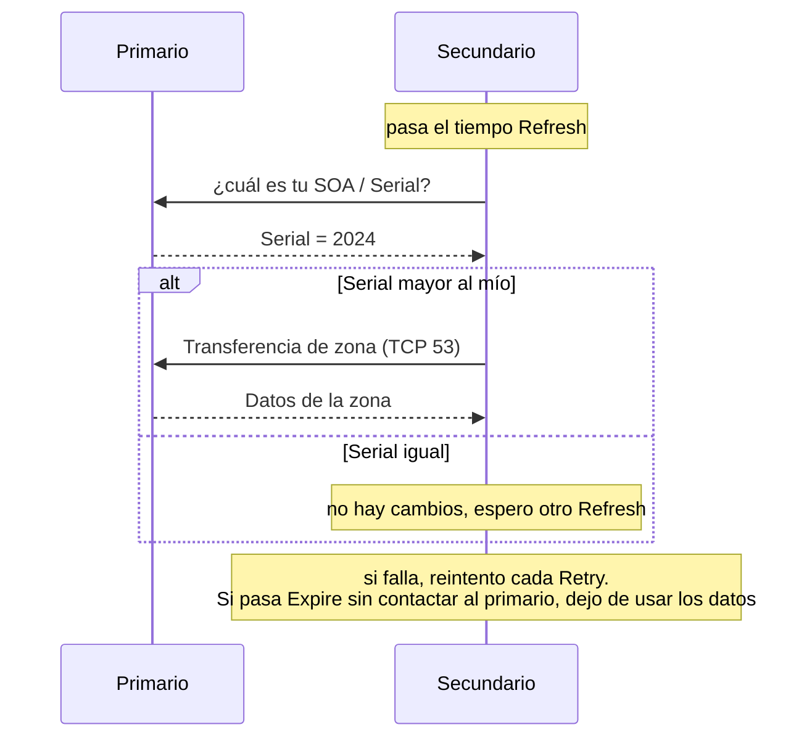

> El diagrama es una ilustración del uso de Serial/Refresh/Retry/Expire según las definiciones de la diapositiva.

## 6. Resolver y resolución local

- Las aplicaciones **no** recorren toda la jerarquía: usan un **resolver** (cliente DNS) que recibe el nombre, **consulta** al servidor DNS configurado en el host, interpreta la respuesta y se la devuelve a la aplicación.
- El host suele tener configurados uno o más **DNS locales / recursivos**.
- Si el servidor tiene la info (propia o en caché) responde enseguida; si no, **consulta a otros servidores**.

**Archivo hosts** (se consulta *antes* que el DNS, según la configuración del sistema):

| SO | Ruta |
|---|---|
| Windows | `C:\Windows\System32\drivers\etc\hosts` |
| Linux | `/etc/hosts` |

Asocia a mano nombres con IP (ej. `192.168.1.10 servidor.interno`). Si se resuelve ahí, **no hay consulta DNS**.

## 7. Consulta recursiva vs. iterativa

| | **Recursiva** | **Iterativa** |
|---|---|---|
| Qué pide el cliente | Una respuesta **final** (o un error) | La **mejor respuesta** que tenga el servidor |
| Quién sigue buscando | El **servidor** consultado, en nombre del cliente | El **que preguntó** (debe consultar al siguiente servidor indicado) |
| Respuesta típica | Dato final / error | "No sé la final, pero **preguntale a este otro**" (referencia) |
| Quién la usa | Resolver del host → DNS local | DNS recursivo → raíz, TLD y autoritativos |

==Idea clave: host → DNS local = **recursiva**. DNS local → raíz/TLD/autoritativos = **iterativa**. Una misma resolución combina ambas. Los servidores raíz y TLD responden normalmente de forma iterativa.==

## 8. Resolución completa (paso a paso)

Caso: el nombre no está ni en `hosts` ni en caché.

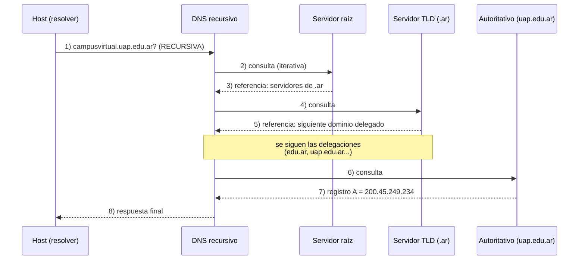

- El **servidor raíz no conoce la IP final**: sabe cómo **seguir** la búsqueda en la jerarquía.
- La respuesta del autoritativo es **autoritativa**; la que viene de caché no (aunque sea válida).

## 9. Caché DNS y TTL

- Los servidores guardan respuestas anteriores en una **caché** para no repetir la resolución completa.
- Ante una consulta, el servidor puede: responder con info **autoritativa** (si administra la zona), responder **desde caché**, o **iniciar una resolución** nueva.
- La validez la limita el **TTL** del registro; cuando llega a 0 el registro vence y hay que pedirlo de nuevo.
- **Respuesta desde caché = no autoritativa**.
- Existe caché tanto en el **host** como en los DNS **recursivos**.

## 10. Forwarders

Un **forwarder** es un DNS al que otros DNS **reenvían las consultas que no pueden resolver localmente**. En vez de consultar raíz/TLD/autoritativos, el DNS local le pregunta al forwarder, que resuelve y devuelve la respuesta.

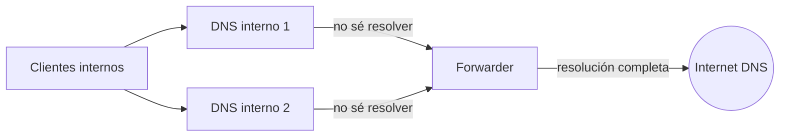

Sirve para: **centralizar** consultas hacia Internet, **caché compartida**, simplificar **políticas de seguridad**, y evitar que todos los DNS internos accedan a Internet.

## 11. Resolución inversa (in-addr.arpa y PTR)

- Directa: nombre → IP. **Inversa:** IP → nombre, con registros **PTR**.
- Las **zonas inversas son independientes** de las directas: que exista el `A` **no implica** que exista el `PTR`. El administrador debe mantener ambos coherentes.
- Útil para logs más legibles y ciertas verificaciones.

Para IPv4 se usa el dominio especial **`in-addr.arpa.`** y se **invierte el orden de los octetos**:

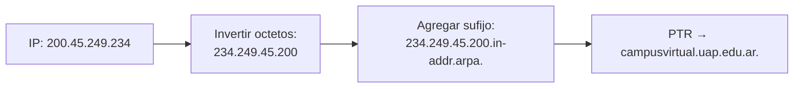

Registro: `234.249.45.200.in-addr.arpa. IN PTR campusvirtual.uap.edu.ar.`

La inversión permite **organizar y delegar** la resolución inversa siguiendo la jerarquía de las redes IP (en el ejemplo, la zona inversa es `249.45.200.in-addr.arpa` para la red 200.45.249.0/24).

### Ejercicio resuelto A – nombres inversos

| IP | Nombre en in-addr.arpa |
|---|---|
| 200.45.249.234 | `234.249.45.200.in-addr.arpa.` |
| 192.168.1.10 | `10.1.168.192.in-addr.arpa.` |
| 10.0.0.1 | `1.0.0.10.in-addr.arpa.` |

> Para la red 200.45.249.0/24 la zona inversa se llama `249.45.200.in-addr.arpa`; dentro de ella el PTR del host .234 se llama `234`.

## 12. DNS sobre UDP y TCP

Ambos con puerto **53** en el servidor.

| | **UDP** | **TCP** |
|---|---|---|
| Uso | Consultas y respuestas **comunes** | Respuestas que **no entran bien en UDP** y **transferencias de zona** |
| Conexión | No requiere | Flujo confiable |
| Si falla | El cliente **reenvía** la consulta | — |

Si una respuesta UDP llega **truncada**, el cliente puede **reintentar por TCP**.

==Idea clave: UDP/53 = habitual. TCP/53 = zona (transferencias) o respuestas grandes/truncadas.==

## 13. BIND

**BIND** (Berkeley Internet Name Domain): implementación muy usada de DNS. El proceso servidor se llama **`named`**.

- **Resolver:** componente cliente que genera las consultas.
- **Servidor DNS:** recibe consultas y responde con sus zonas, su caché o consultando a otros.
- **Root hints:** lista inicial de servidores raíz (nombres + IPv4/IPv6) para arrancar una resolución iterativa cuando **no** se usan forwarders. Ej.: `a.root-servers.net. A 198.41.0.4`.

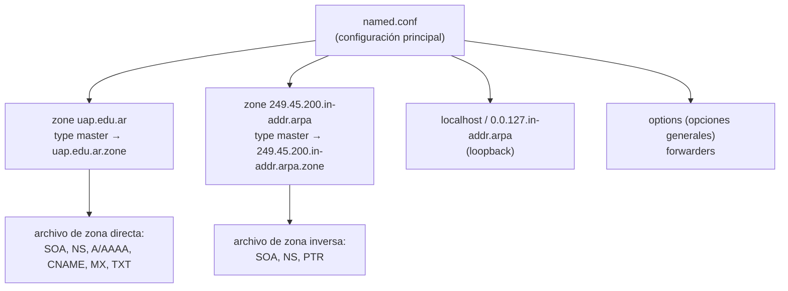

### 13.1 named.conf

| Elemento | Significado |
|---|---|
| `options` | Opciones generales del servidor |
| `zone "uap.edu.ar"` | Zona **directa** administrada localmente |
| `zone "249.45.200.in-addr.arpa"` | Zona **inversa** |
| `localhost` y `0.0.127.in-addr.arpa` | Resolución local de **loopback** |
| `type master` | Este servidor mantiene la **copia principal** de la zona |
| `type forward` | Lo que no resuelve localmente se **reenvía** a otro DNS |
| `forwarders` | Lista de servidores DNS a los que se reenvía |
| `file` | Archivo con los registros de esa zona |

Ejemplo ilustrativo de la estructura (armado según los elementos de la diapositiva):

```
zone "uap.edu.ar" {
    type master;
    file "uap.edu.ar.zone";
};
zone "249.45.200.in-addr.arpa" {
    type master;
    file "249.45.200.in-addr.arpa.zone";
};
```

### 13.2 Archivos de zona

| Archivo | Contenido |
|---|---|
| `localhost.zone` | Zona directa local: `localhost` → `127.0.0.1` |
| `0.0.127.in-addr.arpa.zone` | Zona inversa local: `127.0.0.1` → `localhost` |
| `uap.edu.ar.zone` | Zona directa: **SOA, NS, A/AAAA, CNAME, MX** |
| `249.45.200.in-addr.arpa.zone` | Zona inversa: **SOA, NS, PTR** |

---

# PARTE B – DHCP

## 14. ¿Qué es DHCP?

**DHCP** (Dynamic Host Configuration Protocol) permite que un host obtenga **automáticamente** su configuración de red:

- dirección IP, máscara, **gateway** predeterminado, **servidores DNS** y otros parámetros.

Asignación **dinámica** (por un período) o **reservada/manual** (siempre la misma IP). Simplifica la administración.

### 14.1 Elementos básicos

| Elemento | Qué es |
|---|---|
| **Servidor DHCP** | Asigna IP y parámetros |
| **Cliente DHCP** | Pide la configuración |
| **Alcance (scope)** | Configuración DHCP de **una subred**: direcciones asignables + parámetros |
| **Pool** | Rango de direcciones disponibles para asignación dinámica dentro del scope |

## 15. Proceso DORA

Cuando el cliente se conecta **no tiene IP ni conoce al servidor**, por eso usa **broadcast** y UDP puertos **68 (cliente) / 67 (servidor)**.

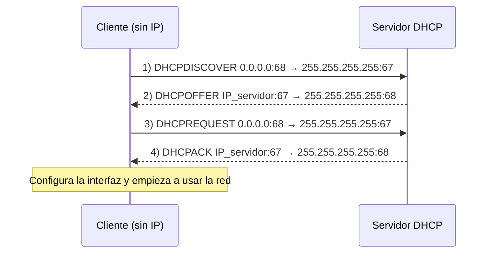

| Mensaje | IP origen | IP destino | UDP origen | UDP destino | Qué hace |
|---|---|---|---|---|---|
| **DISCOVER** | 0.0.0.0 | 255.255.255.255 | 68 | 67 | Busca servidores. Lleva **xid** y **chaddr** (MAC) |
| **OFFER** | IP del servidor | 255.255.255.255 | 67 | 68 | Ofrece IP, máscara, lease, gateway, DNS… Repite el **xid** |
| **REQUEST** | 0.0.0.0 | 255.255.255.255 | 68 | 67 | Acepta **una** oferta (IP pedida + servidor elegido) |
| **ACK** | IP del servidor | 255.255.255.255 | 67 | 68 | Confirma IP, máscara, gateway, lease, etc. |

Detalles que suelen preguntar:

- **xid** (transaction ID): lo genera el cliente en el DISCOVER y permite asociar cada respuesta con su solicitud.
- El OFFER va por **broadcast** porque el cliente todavía no tiene configurada la IP ofrecida.
- Puede haber **varios servidores**, y el cliente recibir **más de una oferta**.
- El REQUEST es **broadcast** → los demás servidores se enteran de que **su oferta no fue elegida**. Ej. del slide: "Cliente elige 192.168.10.101 – Servidor A".
- **Campos del ejemplo de captura:** `src/dest` (IP y puerto), `yiaddr` (IP ofrecida), `transaction ID`, `DHCP Server ID` (servidor elegido), `Lifetime` (tiempo de concesión).

==Idea clave: DORA = Discover, Offer, Request, ACK. Todo por **broadcast** en el intercambio inicial. Cliente = puerto 68, servidor = puerto 67.==

## 16. Lease (arrendamiento) y renovación

- La IP dinámica se entrega por un **lease** (tiempo de concesión). Mientras está vigente el cliente puede usarla y el servidor **no la da a otro**.
- Ejemplo: lease = 8 horas.
- Antes de que venza, el cliente intenta **renovar**.

| Timer | Opción | Cuándo | Con quién | Cómo |
|---|---|---|---|---|
| **T1 – Renewal** | 58 | ~**mitad** del lease | El **mismo** servidor que dio el lease | DHCPREQUEST **unicast** |
| **T2 – Rebinding** | 59 | Si no se renovó al llegar a T2 | **Cualquier** servidor DHCP | DHCPREQUEST **broadcast** |

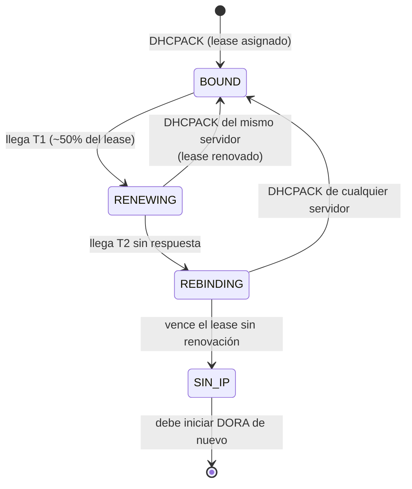

- Si recibe **DHCPACK**, el lease queda renovado y el nuevo lease **cuenta desde ese momento** (puede ser el mismo tiempo u otro).
- T1 y T2 **no son dos únicos intentos**: son dos momentos que **cambian la estrategia**. Si no hay respuesta, reintenta a **la mitad del tiempo restante** (hasta T2 en RENEWING; hasta el vencimiento en REBINDING), con un **mínimo de 60 s** entre intentos.
- Si **vence** el lease sin renovar: la IP deja de ser válida para ese cliente y el servidor puede devolverla al pool y dársela a otro.
- Un cliente **nuevo** sin servidor DHCP disponible **no obtiene configuración**. Uno que ya tiene lease válido puede seguir usándolo mientras no expire.

### Ejercicio resuelto B – tiempos de renovación

Lease = 8 h (si T1 y T2 son los típicos del slide, "aproximadamente a la mitad" para T1):

- T1 ≈ **4 h** → intenta renovar con el mismo servidor por **unicast**.
- Si no responde, reintenta a la mitad del tiempo restante hasta T2 (mín. 60 s entre intentos).
- En **T2** → pasa a rebinding y manda DHCPREQUEST por **broadcast** a cualquier servidor.
- A las **8 h**, si nadie renovó → pierde la IP.

> El valor exacto de T2 no está en el texto del slide; sólo se dice que es la opción 59 y que se activa si no se pudo renovar en T1.

## 17. Parámetros y opciones

**Obligatorios** (para que la concesión sea utilizable y administrable):

| Parámetro | Opción | Para qué |
|---|---|---|
| IP asignada (`yiaddr`) y **máscara** | 1 (máscara) | Identificación y pertenencia a la red |
| **Lease time** | 51 | Cuánto puede usar la IP |
| **T1** Renovación | 58 | Cuándo empezar a renovar con el servidor original |
| **T2** Rebinding | 59 | Cuándo renovar con cualquier servidor |

**Opciones más usadas:**

| Opción | Contenido |
|---|---|
| **3** | Gateway (puerta de enlace) predeterminado |
| **6** | Servidores **DNS** |
| **15** | Nombre de dominio DNS del cliente |
| **28** | Dirección de **broadcast** de la red |
| **42** | Servidores NTP |
| **44** | Servidor WINS |
| **26** | MTU de la interfaz |

## 18. Tipos de asignación y reserva

| | **Dinámica** | **Estática / manual (reserva)** |
|---|---|---|
| IP | Del pool, **temporal** | Una IP **específica** para un cliente |
| Identificación del cliente | — | Normalmente su **MAC** |
| Después del lease | Otro equipo puede usarla | Siempre recibe la **misma** |

**Reserva DHCP:** el dispositivo siempre recibe la misma IP pero **la configuración sigue administrada desde el servidor** (no se configura a mano en el equipo). Sirve para equipos que necesitan una IP conocida y estable.

## 19. DHCP Relay

Los broadcast del cliente **no cruzan routers**. Si el servidor DHCP está en **otra red**, se usa un **relay** (agente de retransmisión), instalado en el dispositivo de encaminamiento que conecta ambas redes.

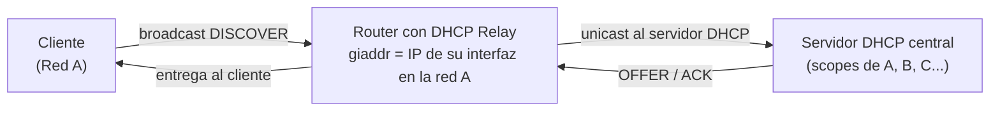

- El relay **no es un servidor**: no decide qué IP asignar, solo **transporta** la solicitud.
- Debe conocer: **la red de clientes** desde la que recibe y **la dirección del servidor DHCP** al que reenvía.
- El servidor central debe tener un **scope por cada subred** que atiende.
- `giaddr`: lo usa el relay para **identificar la red de origen** de la solicitud (así el servidor elige el scope correcto).
- El relay se necesita sobre todo para los **broadcast iniciales**. Una vez que el cliente conoce su IP y la del servidor, en T1 renueva por **unicast** directo.

## 20. Otros mensajes DHCP

| Mensaje | Quién | Para qué |
|---|---|---|
| **DHCPNAK** | Servidor | Rechaza la configuración pedida (ej. en una renovación, la IP ya no es válida para ese servidor) |
| **DHCPDECLINE** | Cliente | Informa que la IP ofrecida **parece estar en uso** por otro equipo |
| **DHCPRELEASE** | Cliente | Deja de usar el lease **voluntariamente** |
| **DHCPINFORM** | Cliente | Ya tiene IP, pide **parámetros adicionales** |

DORA es el intercambio normal inicial; estos aparecen solo cuando la situación lo requiere.

## 21. Formato del mensaje DHCP

| Campo | Significado |
|---|---|
| **ciaddr** | IP del cliente **si ya tiene una** (puede ser 0.0.0.0) |
| **yiaddr** | IP que el servidor **ofrece/asigna** al cliente |
| **siaddr** | IP del servidor |
| **giaddr** | IP usada por el **relay** para identificar la red de la solicitud |
| **chaddr** | Dirección **hardware** del cliente (MAC) |
| **options** | Longitud variable; las opciones de configuración |

---

# PARTE C – Proxy de aplicación

## 22. ¿Qué es y cómo funciona?

Un **proxy de aplicación** es un servidor **intermediario** entre un cliente y un servidor remoto. El cliente **no** habla directo con el servidor final.

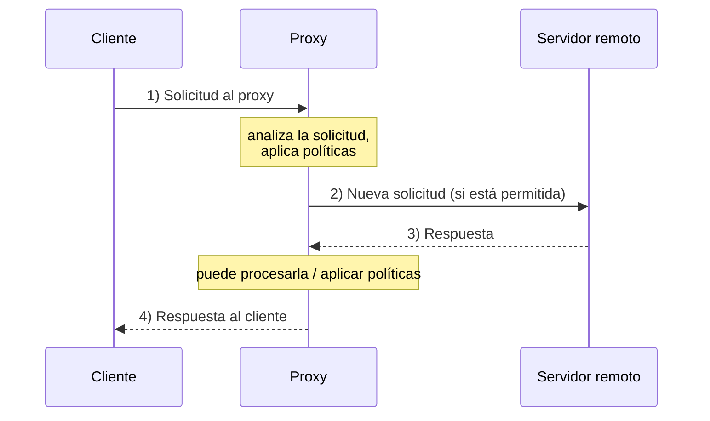

- Son **dos conexiones** distintas: cliente↔proxy y proxy↔servidor.
- Para el servidor remoto, **el cliente es el proxy**.
- Trabaja sobre protocolos de **capa de aplicación**: desencapsula el paquete totalmente, interpreta el protocolo, aplica políticas y genera una nueva comunicación. Puede decidir por el **contenido**, no solo por IP y puertos.
- Servicios clásicos: **HTTP, FTP, Telnet**.

## 23. Funciones adicionales

| Función | Qué hace |
|---|---|
| **Filtrado de contenidos** | Controla qué solicitudes/recursos están autorizados |
| **Caché** | Guarda respuestas para reutilizarlas |
| **Registro (logs)** | Registra las comunicaciones que pasan por el proxy |

## 24. Proxy en una DMZ

El proxy puede ubicarse en una **DMZ** (red intermedia entre LAN e Internet) para aislarlo de la red interna y mejorar el control y la seguridad.

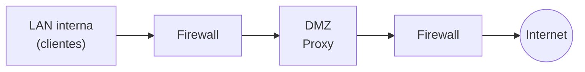

> El diagrama es esquemático: la diapositiva indica solo que la DMZ actúa como red intermedia entre la LAN e Internet y que el proxy se ubica allí.

## 25. Proxy y firewall: se complementan

| | **Firewall** | **Proxy** |
|---|---|---|
| Mira | IP, puertos, protocolos, estado de conexiones | Solicitudes y **contenido** del protocolo de aplicación |
| Decide | **Qué comunicaciones** pueden establecerse | Políticas **más específicas** sobre el contenido |

Ejemplo del slide: el firewall permite TCP al puerto 80 o 443, pero el proxy puede decidir que **determinado sitio o recurso** dentro de ese tráfico web **no** está permitido.

## 26. Proxy inverso (reverse proxy)

Se ubica **delante de uno o más servidores** y recibe las solicitudes **en nombre de ellos**. El cliente se conecta al proxy inverso, y este decide a qué servidor interno reenviar.

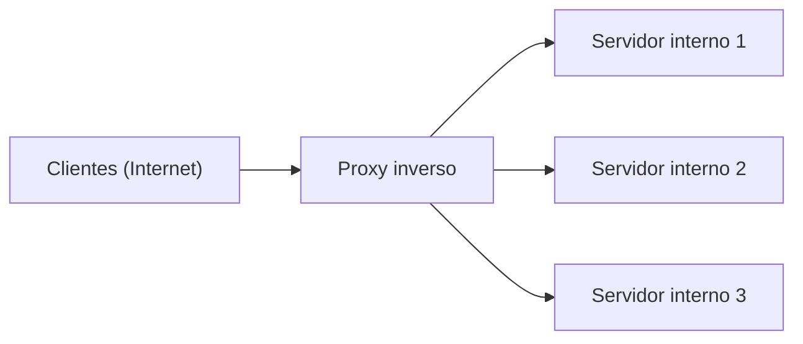

Se usa para: **publicar** servicios internos hacia Internet, **ocultar** la ubicación y estructura de los servidores reales, **balancear carga** y **centralizar controles** de acceso.

| | Proxy (directo) | Proxy inverso |
|---|---|---|
| Se pone delante de | **Clientes** | **Servidores** |
| Protege / representa a | Los clientes internos hacia afuera | Los servidores internos hacia clientes externos |

---

# Ejercicios de práctica (tipo parcial) – con solución

**1.** Un host nuevo se conecta a la red. Detallá los 4 mensajes DHCP indicando IP y puertos de origen/destino.
→ Ver tabla de la sección 15: DISCOVER 0.0.0.0:68 → 255.255.255.255:67; OFFER IP_srv:67 → 255.255.255.255:68; REQUEST 0.0.0.0:68 → 255.255.255.255:67; ACK IP_srv:67 → 255.255.255.255:68.

**2.** ¿Por qué el REQUEST se envía por broadcast si ya hay un servidor elegido?
→ Para que los **otros servidores** que hicieron ofertas sepan que **no fueron elegidos** y liberen la IP ofrecida; el mensaje identifica el servidor elegido.

**3.** El servidor DHCP está en otra subred. ¿Qué hace falta y qué campo identifica la red de origen?
→ Un **DHCP Relay** en el router que une las redes, configurado con la red de clientes y la IP del servidor. El campo es **giaddr**. El servidor debe tener un scope para esa subred.

**4.** Un cliente con lease de 12 h no recibe respuesta del servidor a las 6 h. ¿Qué hace?
→ En **T1** (≈mitad) manda DHCPREQUEST **unicast** al servidor original; si no hay respuesta, reintenta a la mitad del tiempo restante (mín. 60 s). En **T2** (opción 59) pasa a **broadcast** a cualquier servidor. Si vence sin renovar, pierde la IP.

**5.** Escribí el nombre inverso y el PTR de `200.45.249.234`.
→ `234.249.45.200.in-addr.arpa. IN PTR campusvirtual.uap.edu.ar.`

**6.** Describí quién hace consulta recursiva y quién iterativa al resolver `www.ejemplo.com.ar`.
→ El host → DNS local: **recursiva**. DNS local → raíz → TLD `.ar` → ... → autoritativo: **iterativas** (cada uno devuelve una referencia hasta el autoritativo, que da el registro A). Luego el DNS local devuelve la respuesta final al host.

**7.** ¿Qué pasa si el administrador modifica la zona y no cambia el Serial?
→ Los **secundarios no se enteran** del cambio (comparan el Serial) y siguen con datos viejos.

**8.** ¿Cuándo usa DNS TCP en lugar de UDP?
→ Transferencias de zona y respuestas que no entran en UDP (truncadas → el cliente reintenta por TCP). Puerto 53 en ambos.

**9.** Un firewall permite tráfico al puerto 80. ¿Para qué agregar un proxy?
→ El firewall no distingue sitios dentro de HTTP; el proxy interpreta el protocolo y puede **filtrar por contenido/sitio**, cachear y registrar.

---

# Verdadero o Falso (rápido)

| # | Afirmación | Resp. |
|---|---|---|
| 1 | Un servidor secundario es autoritativo para la zona. | **V** |
| 2 | Una respuesta desde caché es autoritativa. | **F** (no lo es, aunque sea válida) |
| 3 | El servidor raíz suele devolver directamente la IP final. | **F** (devuelve una referencia al TLD) |
| 4 | Que exista el registro A implica que existe el PTR. | **F** (zonas independientes) |
| 5 | DHCPDISCOVER sale con IP origen 0.0.0.0 hacia 255.255.255.255, UDP 68 → 67. | **V** |
| 6 | El DHCPOFFER inicial va por unicast a la IP ofrecida. | **F** (broadcast: el cliente aún no la tiene configurada) |
| 7 | En T1 el cliente renueva por broadcast con cualquier servidor. | **F** (T1 = unicast al mismo servidor; T2 = broadcast a cualquiera) |
| 8 | El relay DHCP decide qué IP asignar. | **F** (solo transporta mensajes) |
| 9 | Para el servidor remoto, el cliente de la conexión es el proxy. | **V** |
| 10 | Un proxy inverso se ubica delante de los servidores. | **V** |
