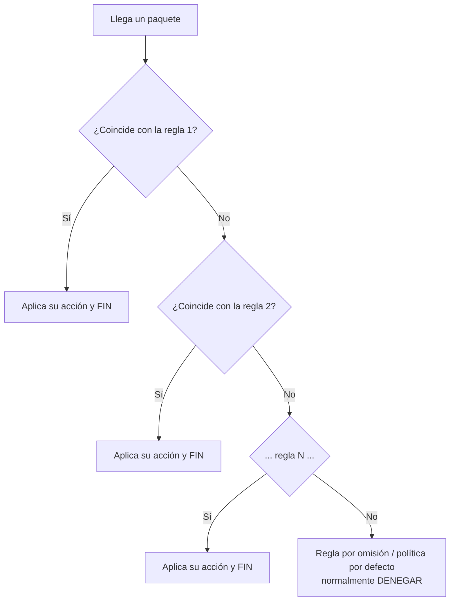
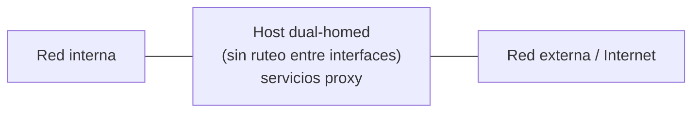
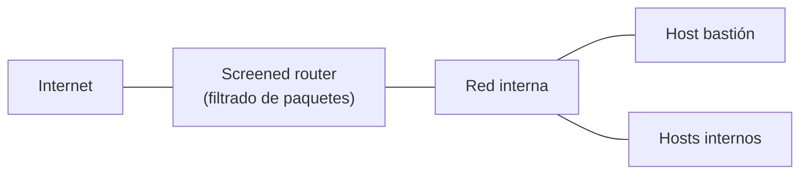
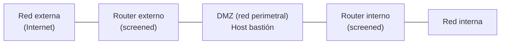
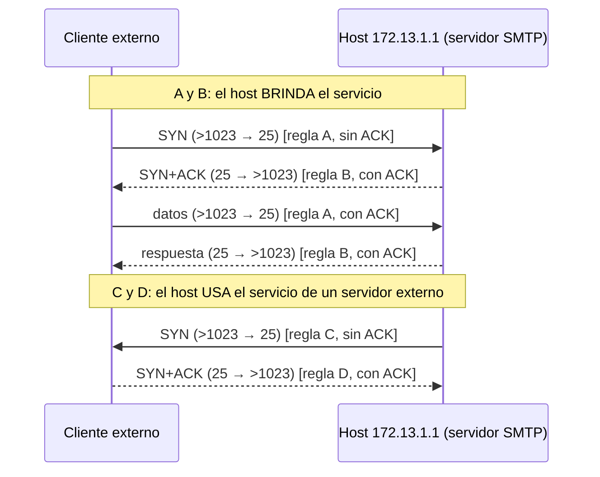
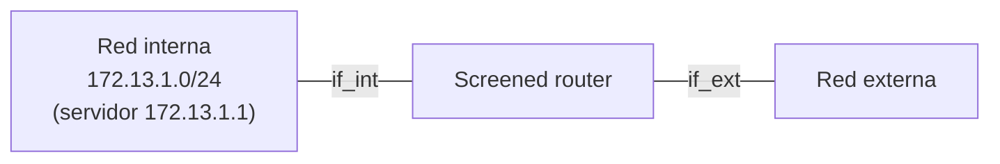
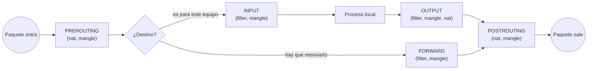
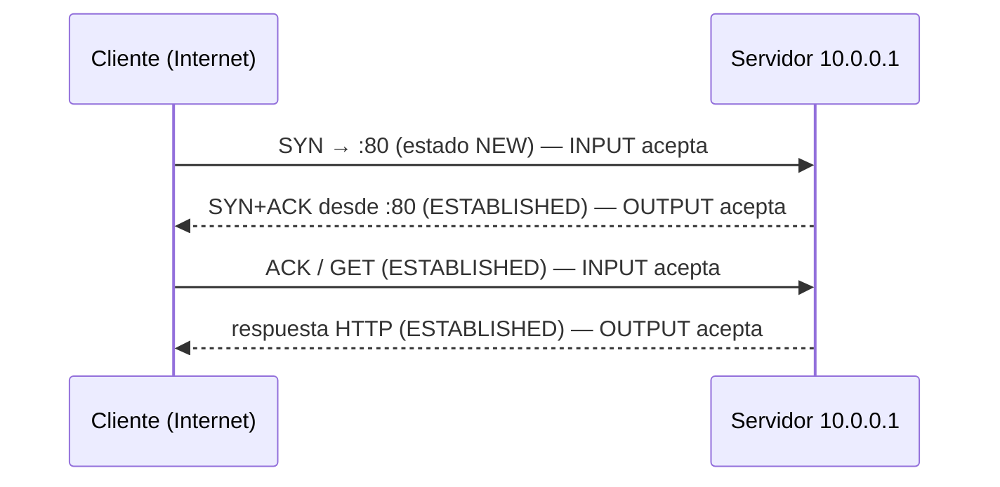

# Unidad 4 – Firewall y filtrado de paquetes (+ iptables)

> Apunte basado en las diapositivas del Ing. Néstor Pereyra. Los diagramas de arquitecturas están redibujados con mermaid a partir de lo que describe el texto de cada diapositiva.

---

## 1. ¿Qué es un firewall?

Un **firewall** es un mecanismo de seguridad que **controla el tráfico entre redes aplicando reglas**. Inspecciona lo que lo atraviesa y decide si cada comunicación se **permite** (cumple las reglas) o se **bloquea** (no cumple la política).

Puede ubicarse:

- entre una **red protegida y una externa**,
- entre **segmentos** de una misma organización,
- o **dentro de un host/servidor** (controla lo que entra y sale de ese equipo).

Puede ser **hardware, software o ambos**.

### 1.1 Qué puede y qué no puede hacer

| ✅ Puede | ❌ No puede |
|---|---|
| **Aplicar políticas** de seguridad (solo lo autorizado) | Controlar tráfico que **no pasa** por él |
| **Registrar** actividad (logs) | Impedir por sí solo acciones maliciosas de **usuarios internos** |
| **Limitar la exposición** (qué sistemas/servicios son accesibles) | Proteger totalmente frente a amenazas **nuevas o desconocidas** |
| Ser **punto de control** (decisiones concentradas) | Reemplazar antimalware ni la seguridad propia de los hosts |

==Idea clave: **Firewall ≠ seguridad completa.** Es una pieza de una estrategia más amplia.==

## 2. Estrategias básicas de seguridad (principios)

| Principio | Idea |
|---|---|
| **Menor privilegio** | Dar solo los permisos necesarios. En filtrado: permitir solo el tráfico realmente necesario |
| **Defensa en profundidad** | No depender de un único mecanismo: varias capas, para que la falla de una no comprometa todo |
| **Punto de ahogo (choke point)** | Forzar el tráfico por uno o pocos puntos que se puedan monitorear/controlar (ej. firewall perimetral por el que debe pasar todo) |
| **Eslabón más débil** | La seguridad global depende del componente más vulnerable: hay que reforzarlo o monitorearlo |
| **A prueba de fallos** | Ante un error, quedar en el estado **más seguro** |
| **Participación universal** | Los mecanismos deben ser respetados por **toda** la organización |
| **Diversidad de defensas** | No depender de una única tecnología |
| **Simplicidad** | Cuanto más complejo, más difícil de entender y asegurar |

Ejemplo del slide (menor privilegio + defensa en profundidad): un servidor web detrás de un firewall perimetral que solo permite 443, y además el propio servidor tiene firewall local permitiendo solo 443 y SSH desde la red de administración, más hardening.

### 2.1 A prueba de fallos: políticas por omisión

| Política | Significado |
|---|---|
| **Permitir por omisión** | Todo permitido excepto lo que se bloquea explícitamente |
| **Denegar por omisión** | Todo bloqueado excepto lo que se permite explícitamente |

==Idea clave: desde la seguridad se **prefiere denegar por omisión**.==

## 3. Conceptos básicos para diseñar firewalls

| Concepto | Qué es |
|---|---|
| **Host bastión** | Sistema expuesto o especialmente accesible desde otras redes → debe estar **fuertemente protegido** (ej. servidor web accesible desde Internet) |
| **Host dual-homed** | Equipo de propósito general con **al menos dos interfaces** de red |
| **Screened router** | Router que aplica **filtrado de paquetes** |
| **Red perimetral o DMZ** | Red intermedia entre una red protegida y una externa |
| **Servidor proxy** | Intermediario entre clientes internos y servidores externos |

## 4. Filtrado de paquetes

Mecanismo que controla **selectivamente qué paquetes** atraviesan un dispositivo o entran/salen de un host, mediante **reglas**. Cada paquete es **permitido** (cumple una regla que lo autoriza) o **bloqueado** (coincide con una de denegación o no cumple lo permitido). Se hace en **routers y en hosts**.

### 4.1 Criterios de filtrado

IP origen · IP destino · protocolo (TCP/UDP/ICMP) · puerto origen · puerto destino · tipo de mensaje ICMP · interfaz de entrada · interfaz de salida · otros según el firewall.

### 4.2 Por dirección vs. por servicio

| | Qué mira | Ejemplo |
|---|---|---|
| **Filtrado por dirección** | IP origen y/o destino, sin considerar el protocolo de aplicación | Permitir solo desde ciertos hosts; bloquear orígenes sospechosos |
| **Filtrado por servicio** | Además: **protocolo + puerto origen + puerto destino** | Decidir qué servicios se permiten |

### 4.3 Servicio entrante vs. saliente

El sentido lo define **dónde está el servidor**:

| Servicio | Servidor | Cliente |
|---|---|---|
| **Saliente** | En la red **externa** | En la red **interna** |
| **Entrante** | En la red **interna** | En la red **externa** |

En ambos casos los paquetes circulan **en los dos sentidos** (solicitud y respuesta) → permitir un servicio implica considerar **ida y vuelta**.

### 4.4 Orden de evaluación de reglas



- Se evalúan **en orden**, desde la primera, y se aplica **la primera que coincide** (no se siguen evaluando).
- Por eso: primero las **más específicas**, al final una **general**, y terminar con una regla explícita **por omisión (denegar)**.

### 4.5 ¿Dónde se aplican? (input / output / forward)

| Sentido | Qué paquetes |
|---|---|
| **Entrada (input)** | Destinados al **propio equipo** |
| **Salida (output)** | Generados por el **propio equipo** |
| **Reenvío (forward)** | **Atraviesan** el equipo porque actúa como **router** |

Además se pueden usar reglas distintas según la **interfaz** de entrada/salida.

## 5. Arquitecturas de firewall

### 5.1 Host dual-homed

Un equipo con **dos interfaces** entre la red interna y la externa. **Se deshabilita el ruteo directo** entre ellas.



- Hosts internos y externos pueden hablar **con el dual-homed**, pero **no directamente entre sí**.
- Los servicios hacia afuera se brindan desde el propio host (ej. **servicios proxy**). No hay comunicación IP directa interna↔externa.

### 5.2 Host screened (screened host)

**Screened router** (filtra paquetes) + **host bastión en la red interna**.



El router se configura para que:

- las conexiones externas **solo alcancen ciertos servicios del bastión**,
- se **limite el acceso directo** al resto de hosts internos,
- se controlen también las conexiones **hacia afuera**.

**Deficiencias:**

- El bastión está **dentro de la red interna**: si lo comprometen, desde ahí pueden ir **directo al resto** de la red interna.
- El screened router es un **punto único de falla**: si lo comprometen, se afecta toda la protección.
- → Se agrega una capa extra de aislamiento: **DMZ**.

### 5.3 Subred screened / DMZ

Se agrega una **red perimetral (DMZ)** entre la externa y la interna. Forma clásica: **router externo + router interno + uno o más bastiones en la DMZ**.



| Componente | Función |
|---|---|
| **Host bastión** (en la DMZ) | Brinda servicios accesibles desde afuera; puede actuar de **proxy** para clientes internos; debe estar **especialmente asegurado** |
| **Router interno** | Separa DMZ de la red interna; protege la interna **de Internet y de la propia DMZ**; limita qué servicios hablan entre DMZ e interna; hace **gran parte del filtrado** |
| **Router externo** | Conecta la DMZ con la externa; protege la DMZ del tráfico de Internet; filtra tráfico entrante; **bloquea paquetes peligrosos y con direcciones de origen fraudulentas**; puede complementar/duplicar reglas del interno (capa adicional) |

- Entre bastión y red interna deberían permitirse **solo los servicios necesarios**, e incluso restringidos a **hosts internos concretos**.
- Comprometer un host de la DMZ **no implica** comprometer automáticamente la red interna.

### 5.4 Serie de redes perimetrales

Varias redes perimetrales **en capas**: lo más expuesto/vulnerable en las zonas **más externas**, lo sensible protegido por capas adicionales. Cada nivel con políticas **diferentes y más restrictivas hacia adentro**. Si todas las capas permiten lo mismo, no mejora la seguridad.

### 5.5 ¿Dónde realizar el filtrado?

| Lugar | Ejemplo |
|---|---|
| **Puntos de ahogo** | Firewalls y routers perimetrales |
| **Hosts bastión** | Sistemas especialmente expuestos |
| **Hosts internos** | Servidores/equipos que necesitan protección adicional |

Aplicar controles en varios niveles = **defensa en profundidad**.

## 6. Ventajas y limitaciones del filtrado de paquetes

| Ventajas | Limitaciones |
|---|---|
| Un único punto de filtrado puede proteger una **red completa** | Reglas **complejas** de configurar y verificar |
| **Transparente** para el usuario | Algunos protocolos son **difíciles de filtrar** bien |
| No requiere software/config especial en **clientes** | No siempre puede aplicar políticas por **usuario o contenido** |
| Disponible en muchos routers/sistemas | Los productos de filtrado también tienen **errores/vulnerabilidades** |

## 7. Estructura de una regla de filtrado

Campos de la tabla: **Interfaz · Sentido · IP origen · IP destino · Protocolo · Puerto origen · Puerto destino · ACK · Acción**.

- Se analizan **en el orden declarado**, hasta la **primera** que concuerde.
- Un **guión (—)** en un campo significa que ese campo **no forma parte** de la regla.

Ejemplo del slide:

| Interfaz | Sentido | IP origen | IP destino | Proto | P. origen | P. destino | ACK | Acción |
|---|---|---|---|---|---|---|---|---|
| int_0 | Entrante | 200.10.1.0/24 | 172.16.1.10 | TCP | cualquiera | 443 | — | Permitir |

Lectura: por la interfaz int_0 entra tráfico TCP desde la red 200.10.1.0/24 hacia el 172.16.1.10 puerto 443 (HTTPS) → se permite.

### 7.1 El bit ACK en TCP

En el filtrado TCP, el bit ACK distingue:

- el segmento que **intenta iniciar** una conexión → **sin ACK** (solo SYN),
- los segmentos de una conexión **ya iniciada** → **con ACK**.

Sirve para **aceptar respuestas** a conexiones iniciadas desde adentro **sin permitir que desde afuera se inicien nuevas**. Si un atacante manda un ACK artificial en un supuesto primer paquete, el destino lo asocia a una conexión que no existe y **lo ignora**.

### 7.2 Stateless vs. stateful

| | **Stateless (sin estado)** | **Stateful (con estado)** |
|---|---|---|
| Analiza | Cada paquete **independiente** (IP, protocolo, puertos, flags TCP) | Mantiene info de **conexiones** |
| Memoria | No recuerda conexiones anteriores | Sabe si el paquete es de una conexión **nueva, establecida o relacionada** |

## 8. Ejercicios resueltos de las diapositivas

### 8.1 Host 172.13.1.1 con firewall propio (interfaz int_0)

Política: (1) recibir conexiones SMTP (TCP 25) desde la red externa; (2) acceder al SMTP (TCP 25) de cualquier servidor externo; (3) todo lo demás **denegado**.

| Regla | Interfaz | Sentido | IP origen | IP destino | Proto | P. origen | P. destino | ACK | Acción |
|---|---|---|---|---|---|---|---|---|---|
| A | int_0 | Entrante | 0.0.0.0/0 | 172.13.1.1 | TCP | >1023 | 25 | Sí/No | Permitir |
| B | int_0 | Saliente | 172.13.1.1 | 0.0.0.0/0 | TCP | 25 | >1023 | **Sí** | Permitir |
| C | int_0 | Saliente | 172.13.1.1 | 0.0.0.0/0 | TCP | >1023 | 25 | Sí/No | Permitir |
| D | int_0 | Entrante | 0.0.0.0/0 | 172.13.1.1 | TCP | 25 | >1023 | **Sí** | Permitir |
| E | — | — | 0.0.0.0/0 | 0.0.0.0/0 | — | — | — | — | **Denegar** |



- **A y B** → el host **brinda** el servicio (servidor).
- **C y D** → el host **accede** al servicio (cliente).
- **E** → política por defecto.
- ¿Por qué ACK = Sí en B y D? Son **respuestas**: nunca pueden ser el primer paquete de una conexión. En A y C el cliente manda SYN (sin ACK) y luego segmentos con ACK → "Sí/No".

### 8.2 Screened router (if_int / if_ext)

Política: (1) hosts de la red interna **172.13.1.0/24** acceden al SMTP de servidores externos; (2) el servidor interno **172.13.1.1** recibe SMTP desde afuera; (3) todo lo demás denegado.

| Regla | Interfaz | Sentido | IP origen | IP destino | Proto | P. origen | P. destino | ACK | Acción |
|---|---|---|---|---|---|---|---|---|---|
| A | if_int | Forwarding | 172.13.1.0/24 | 0.0.0.0/0 | TCP | >1023 | 25 | Sí/No | Permitir |
| B | if_ext | Forwarding | 0.0.0.0/0 | 172.13.1.0/24 | TCP | 25 | >1023 | **Sí** | Permitir |
| C | if_ext | Forwarding | 0.0.0.0/0 | 172.13.1.1/32 | TCP | >1023 | 25 | Sí/No | Permitir |
| D | if_int | Forwarding | 172.13.1.1/32 | 0.0.0.0/0 | TCP | 25 | >1023 | **Sí** | Permitir |
| E | — | E/S/F | 0.0.0.0/0 | 0.0.0.0/0 | — | — | — | — | **Denegar** |



| Regla | Qué permite |
|---|---|
| **A** | Salida de los clientes internos hacia SMTP externo (solicitud, entra por if_int) |
| **B** | Vuelta de esas respuestas (solo con ACK, entra por if_ext) |
| **C** | Conexiones externas hacia el servidor 172.13.1.1:25 (solicitud) |
| **D** | Respuestas del servidor hacia afuera (solo con ACK, entra por if_int) |
| **E** | Denegar todo lo demás (entrada/salida/forwarding) |

Fijate que la interfaz indicada es **por la que el paquete ingresa al router**, y el sentido es **Forwarding** (el router solo reenvía).

### 8.3 Pregunta del slide: ICMP Echo

*"Piensen y planteen los cambios para que el servidor responda solicitudes ICMP Echo Request provenientes de la red interna. ¿Podrá, con esa misma configuración, generar Echo Request?"*

Resolución (planteo propio, la diapositiva solo deja la pregunta). Para que el servidor **responda pings** (Echo Request = ICMP tipo 8; Echo Reply = tipo 0) hay que agregar, **antes de la regla E**:

| Regla | Interfaz | Sentido | IP origen | IP destino | Proto | Acción |
|---|---|---|---|---|---|---|
| F | int_0 | Entrante | red interna | 172.13.1.1 | ICMP **Echo Request (8)** | Permitir |
| G | int_0 | Saliente | 172.13.1.1 | red interna | ICMP **Echo Reply (0)** | Permitir |

(ICMP no tiene puertos ni bit ACK; el campo útil es el **tipo de mensaje ICMP**.)

**¿Podrá generar Echo Request con esa misma configuración? No.** Las reglas F y G solo dejan **recibir** Echo Request y **enviar** Echo Reply. Para que el servidor *haga* ping habría que permitir también el Echo Request **saliente** y el Echo Reply **entrante** (otras dos reglas). Las reglas A–D son solo TCP/25.

---

# Parte 2 – iptables

## 9. ¿Qué es iptables?

Herramienta de administración de reglas de filtrado en **Linux**. Forma parte del framework **Netfilter** del kernel. Permite: permitir/bloquear tráfico, controlar paquetes **destinados** al host, **generados** por el host, **reenviados** entre redes y hacer **NAT**.

==Idea clave: **iptables configura** las reglas; **Netfilter las aplica** en el kernel.==

## 10. Sintaxis general

```
iptables -t <tabla> -<comando> <cadena> {opciones} -j <acción>
```

| Parte | Define |
|---|---|
| `-t tabla` | El tipo de tratamiento que se hace al paquete (si se omite, usa **filter**) |
| `-comando` | Qué operación hacer sobre las reglas |
| `cadena` | En qué punto del recorrido se aplica |
| `opciones` | Condiciones que debe cumplir el paquete |
| `-j acción` | Qué hacer si coincide |

Ejemplo: `iptables -t filter -A INPUT -p tcp --dport 22 -j ACCEPT`

## 11. Tablas

| Tabla | Para qué | ¿Modifica el paquete? |
|---|---|---|
| **filter** | **Permitir o bloquear** tráfico. **Es la tabla por defecto** | No |
| **nat** | **Traducción** de direcciones/puertos. Interviene sobre todo al **establecer nuevas conexiones** | Sí |
| **mangle** | Modificaciones específicas (ej. **marcar** tráfico) | Sí |

## 12. Comandos

| Comando | Función |
|---|---|
| `-A` | **Agrega** al **final** de la cadena (Append) |
| `-D` | **Elimina** una regla |
| `-D <n>` | Elimina la regla número **n** |
| `-I <n>` | **Inserta** una regla en la posición **n** |
| `-R <n>` | **Reemplaza** la regla número n |
| `-F` | **Vacía** la cadena (borra sus reglas) |
| `-L` | **Lista** las reglas |

- `iptables -A INPUT ...` → al final de INPUT.
- `iptables -I INPUT 1 ...` → la deja como **primera** regla de INPUT (importa por el orden de evaluación).

## 13. Cadenas

| Cadena | Paquetes que analiza | Tablas |
|---|---|---|
| **INPUT** | Destinados al **propio equipo** | filter, mangle |
| **OUTPUT** | **Generados** por el propio equipo | filter, mangle, nat |
| **FORWARD** | Atraviesan el equipo (**reenviados**) | filter, mangle |
| **PREROUTING** | Recibidos, **antes** de decidir el encaminamiento | nat, mangle |
| **POSTROUTING** | **Antes de salir** del equipo | nat, mangle |

Recorrido de un paquete (esquema conceptual según las definiciones de cada cadena):



Regla práctica: **DNAT en PREROUTING** (cambia el destino antes de rutear), **SNAT/MASQUERADE en POSTROUTING** (cambia el origen antes de salir), **filtrado en INPUT/OUTPUT/FORWARD**.

## 14. Opciones de una regla

| Opción | Función |
|---|---|
| `-i <interfaz>` | Interfaz por la que **ingresa** |
| `-o <interfaz>` | Interfaz por la que **sale** |
| `-s <IP/red>` | IP o red de **origen** |
| `-d <IP/red>` | IP o red de **destino** |
| `-p <protocolo>` | tcp, udp, icmp… |
| `--sport <puerto>` | Puerto de **origen** |
| `--dport <puerto>` | Puerto de **destino** |

Ejemplo: `iptables -A INPUT -i eth0 -s 192.168.1.0/24 -p tcp --dport 22 -j ACCEPT`
→ Acepta, por INPUT, lo que entra por eth0 desde 192.168.1.0/24, TCP al puerto 22 (SSH).

## 15. Acciones (`-j`)

| Acción | Resultado | Tabla | Cadenas |
|---|---|---|---|
| **DROP** | **Descarta** el paquete (en silencio) | filter | INPUT, OUTPUT, FORWARD |
| **ACCEPT** | **Acepta** el paquete | filter | INPUT, OUTPUT, FORWARD |
| **REJECT** | Descarta y **notifica el rechazo** al origen | filter | INPUT, OUTPUT, FORWARD |

**Acciones de NAT:**

| Acción | Resultado | Tabla | Cadena |
|---|---|---|---|
| **SNAT** `--to-source x.x.x.x` | Cambia la IP de **origen** | nat | POSTROUTING |
| **DNAT** `--to-destination x.x.x.x` | Cambia la IP de **destino** | nat | PREROUTING |
| **MASQUERADE** | Cambia el origen usando **la IP de la interfaz de salida** | nat | POSTROUTING |

Ejemplos del slide:

```bash
# SNAT: salida de la red 192.168.1.0/24 por eth0 con IP pública fija
iptables -t nat -A POSTROUTING -s 192.168.1.0/24 -o eth0 -j SNAT --to-source 200.45.249.10

# DNAT: lo que llega a eth0 al puerto 80 se manda al servidor interno 192.168.1.20
iptables -t nat -A PREROUTING -i eth0 -p tcp --dport 80 -j DNAT --to-destination 192.168.1.20

# MASQUERADE: igual que SNAT pero usa la IP actual de eth0 (útil si la IP pública es dinámica)
iptables -t nat -A POSTROUTING -s 192.168.1.0/24 -o eth0 -j MASQUERADE
```

> La explicación "útil si la IP pública es dinámica" es una aclaración propia; el slide solo dice que MASQUERADE usa la dirección de la interfaz de salida.

| | SNAT | MASQUERADE |
|---|---|---|
| IP de origen nueva | La que **vos indicás** (`--to-source`) | La de la **interfaz de salida** |

## 16. Política predeterminada (`-P`)

```bash
iptables -P INPUT DROP
iptables -P OUTPUT DROP
iptables -P FORWARD DROP
```

- Define la acción para todo paquete de esa cadena que **no coincidió con ninguna regla anterior**.
- **No agrega una regla** a la lista: define el comportamiento por defecto de la cadena.
- Solo aplica a las **cadenas integradas**; las cadenas creadas por el usuario no tienen política propia.
- Con DROP en las tres: **política por defecto = denegar**.

## 17. Ejemplos básicos

| Qué hace | Comando |
|---|---|
| Permitir toda salida por eth0 | `iptables -A OUTPUT -o eth0 -j ACCEPT` |
| Permitir entrada HTTP desde 192.168.0.0/24 al host 192.168.0.1 | `iptables -A INPUT -s 192.168.0.0/24 -d 192.168.0.1 -p tcp --dport 80 -j ACCEPT` |
| Rechazar todo reenvío cuyo origen sea 192.168.0.7 | `iptables -A FORWARD -s 192.168.0.7 -j REJECT` |

## 18. Ejemplo práctico: servidor HTTP (10.0.0.1)

Consigna: (1) diseñar las políticas para que el servidor dé **HTTP a cualquier host de Internet**, con política por defecto **denegar**; (2) generar el script iptables.

### 18.1 Política diseñada (tabla)

| Regla | Interfaz | Sentido | IP origen | IP destino | Proto | P. origen | P. destino | ACK | Acción |
|---|---|---|---|---|---|---|---|---|---|
| A | eth0 | Entrante | 0.0.0.0/0 | 10.0.0.1 | TCP | 1024:65535 | 80 | Sí/No | Permitir |
| B | eth0 | Saliente | 10.0.0.1 | 0.0.0.0/0 | TCP | 80 | 1024:65535 | **Sí** | Permitir |
| C | — | — | cualquiera | cualquiera | — | — | — | — | Denegar (por defecto) |

### 18.2 Script SIN estados (usa el bit ACK)

```bash
iptables -A INPUT  -i eth0 -s 0.0.0.0/0 -d 10.0.0.1 -p tcp --sport 1024:65535 --dport 80 -j ACCEPT
iptables -A OUTPUT -o eth0 -s 10.0.0.1 -d 0.0.0.0/0 -p tcp --sport 80 --dport 1024:65535 --tcp-flags ACK ACK -j ACCEPT
iptables -P INPUT DROP
iptables -P OUTPUT DROP
iptables -P FORWARD DROP
```

- `INPUT`: acepta lo que entra al servidor al puerto 80 desde puertos altos del cliente.
- `OUTPUT`: acepta lo que sale del puerto 80 hacia puertos altos **con el bit ACK activo** (`--tcp-flags ACK ACK` = "de los flags examinados, ACK debe estar en 1"): son las respuestas.
- Las tres `-P` ponen **DROP por defecto**.

### 18.3 Script CON estados (`-m state`)

```bash
iptables -A INPUT  -i eth0 -s 0.0.0.0/0 -d 10.0.0.1 -p tcp --sport 1024:65535 --dport 80 -m state --state NEW,ESTABLISHED -j ACCEPT
iptables -A OUTPUT -o eth0 -s 10.0.0.1 -d 0.0.0.0/0 -p tcp --sport 80 --dport 1024:65535 -m state --state ESTABLISHED -j ACCEPT
iptables -P INPUT DROP
iptables -P OUTPUT DROP
iptables -P FORWARD DROP
```

- Entrada: acepta conexiones **NEW** (inicio) y **ESTABLISHED** (ya establecidas).
- Salida: solo **ESTABLISHED** → el servidor **no puede iniciar** conexiones desde el puerto 80, solo responder.



### 18.4 Estados de conexión

Sintaxis: `… -m state --state NEW,ESTABLISHED`

| Estado | Significado |
|---|---|
| **NEW** | Inicio de una conexión nueva (o paquetes que intentan crearla) |
| **ESTABLISHED** | Pertenece a una conexión **ya conocida y establecida** |
| **RELATED** | Nueva comunicación **relacionada** con otra ya existente |
| **INVALID** | No se puede asociar con una conexión conocida |

==Idea clave: sin estados el firewall confía en el bit ACK (stateless). Con estados, iptables hace seguimiento de conexión (stateful) y solo deja pasar respuestas de conexiones conocidas.==

---

# Ejercicios de práctica (tipo parcial) – con solución

**1.** Diseñá reglas (tabla) para un host 10.1.1.5 que ofrece HTTPS (TCP 443) a todo Internet y no hace nada más.
→ A: Entrante, 0.0.0.0/0 → 10.1.1.5, TCP, >1023 → 443, ACK Sí/No, Permitir. B: Saliente, 10.1.1.5 → 0.0.0.0/0, TCP, 443 → >1023, ACK Sí, Permitir. C: Denegar todo.

**2.** Escribí el script iptables del ejercicio 1 (host 10.1.1.5, eth0) sin estados.
```bash
iptables -A INPUT  -i eth0 -d 10.1.1.5 -p tcp --sport 1024:65535 --dport 443 -j ACCEPT
iptables -A OUTPUT -o eth0 -s 10.1.1.5 -p tcp --sport 443 --dport 1024:65535 --tcp-flags ACK ACK -j ACCEPT
iptables -P INPUT DROP
iptables -P OUTPUT DROP
iptables -P FORWARD DROP
```

**3.** En INPUT tenés primero `iptables -A INPUT -s 10.0.0.9 -j DROP` y después `iptables -A INPUT -j ACCEPT`. ¿Qué pasa con los paquetes de 10.0.0.9? ¿Y si invertís el orden?
→ Con ese orden se **descartan**: se evalúa **en orden** y gana la primera que coincide (la DROP). Si la ACCEPT general estuviera primera, **aceptaría todo** y la DROP nunca se evaluaría (por eso van primero las reglas específicas).

**4.** Querés que una regla quede **primera** en INPUT. ¿Qué comando?
→ `iptables -I INPUT 1 ...`

**5.** Un router Linux debe publicar el servidor web 192.168.1.20 en el puerto 80 de su IP pública por eth0. ¿Qué regla y en qué cadena?
→ `iptables -t nat -A PREROUTING -i eth0 -p tcp --dport 80 -j DNAT --to-destination 192.168.1.20` (DNAT, **PREROUTING**).

**6.** Los clientes de 192.168.1.0/24 deben salir a Internet por eth0 con la IP de la interfaz.
→ `iptables -t nat -A POSTROUTING -s 192.168.1.0/24 -o eth0 -j MASQUERADE`

**7.** Diferencia entre DROP y REJECT.
→ DROP descarta **en silencio**; REJECT descarta y **notifica el rechazo** al origen.

**8.** ¿Qué hace `iptables -P FORWARD DROP`?
→ Pone política por defecto de FORWARD en denegar: todo paquete que atraviese el equipo y no coincida con una regla anterior se descarta. No agrega una regla.

---

# Verdadero o Falso (rápido)

| # | Afirmación | Resp. |
|---|---|---|
| 1 | Un firewall protege el tráfico que no pasa por él. | **F** |
| 2 | Desde el punto de vista de seguridad se prefiere "permitir por omisión". | **F** (denegar por omisión) |
| 3 | Se aplica la última regla que coincide con el paquete. | **F** (la **primera**) |
| 4 | En la arquitectura host screened, si cae el bastión el atacante puede ir al resto de la red interna. | **V** |
| 5 | En la DMZ el bastión está dentro de la red interna. | **F** (está en la red perimetral) |
| 6 | El router externo puede bloquear paquetes con direcciones de origen fraudulentas. | **V** |
| 7 | Un firewall stateless mantiene información de las conexiones anteriores. | **F** |
| 8 | Permitir un servicio implica considerar el tráfico de ida y de vuelta. | **V** |
| 9 | La tabla por defecto de iptables es `nat`. | **F** (`filter`) |
| 10 | DNAT se usa en PREROUTING y SNAT en POSTROUTING. | **V** |
| 11 | `-P` agrega una regla al final de la cadena. | **F** (define la política por defecto) |
| 12 | `-A` agrega al final; `-I n` inserta en la posición n. | **V** |
| 13 | El estado RELATED es una conexión ya establecida. | **F** (es una comunicación nueva **relacionada** con una existente; ESTABLISHED es la ya establecida) |
| 14 | Iptables aplica las reglas en el kernel. | **F** (iptables las configura; **Netfilter** las aplica) |
