# Unidad 5 – Seguridad en Redes

> Apunte basado en las diapositivas del Ing. Néstor Pereyra. Incluye criptografía, hash/MAC/firma, PKI, TLS, VPN e IPsec.
> Los esquemas están redibujados con mermaid siguiendo lo que describe el texto de cada diapositiva.

---

## 1. Seguridad de la información

Busca proteger la información y los recursos asociados frente a accesos, modificaciones o indisponibilidad **no autorizados**. En esta unidad el foco es la información **mientras circula por la red**.

| Propiedad | Significado |
|---|---|
| **Confidencialidad** | La información solo es accesible por entidades **autorizadas** |
| **Integridad** | La información solo se modifica de manera **autorizada** |
| **Disponibilidad** | Información y recursos disponibles para usuarios autorizados **cuando los necesiten** |

Además, en una comunicación segura importan:

| Propiedad | Significado | Ejemplo |
|---|---|---|
| **Autenticación** | Verificar que una entidad es quien dice ser | Comprobar que hablamos con el servidor esperado |
| **No repudio** | Evitar que una entidad **niegue** haber participado o hecho una acción | Demostrar que una entidad originó un mensaje/transacción |

## 2. Vulnerabilidad, amenaza e incidente

| Término | Definición | Ejemplo |
|---|---|---|
| **Vulnerabilidad** | **Debilidad** en un activo, sistema o mecanismo de protección | Servidor con software desactualizado |
| **Amenaza** | Situación/evento/actor que **puede aprovechar** una vulnerabilidad | Atacante capaz de explotar esa falla |
| **Incidente** | Evento adverso que afecta activos/servicios; ocurre cuando **la amenaza se concreta** | El atacante compromete el servidor |

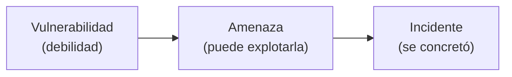

## 3. Ataques pasivos y activos

| | **Pasivos** | **Activos** |
|---|---|---|
| Objetivo | Obtener información **sin modificar** recursos | **Alterar** recursos, datos o funcionamiento |
| Cómo | **Observación / escucha** | Modificación, suplantación, repetición o interrupción |
| Detección | **Difíciles** de detectar | Más evidentes, aunque no siempre prevenibles |
| Defensa | Se orienta a la **prevención** | Requiere además **detección y recuperación** |
| Resumen | Observa | Modifica o interfiere |

### 3.1 Ataques pasivos

- **Divulgación del contenido:** el atacante intercepta y **lee** lo transmitido (conversación, correo, archivo).
- **Análisis de tráfico:** aunque el contenido esté cifrado, se observa **quién** se comunica con quién, la **frecuencia** y la **longitud/volumen** del tráfico → revela patrones.

==Idea clave: el cifrado oculta el **contenido**, pero no necesariamente **todos los patrones** del tráfico.==

### 3.2 Ataques activos

| Ataque | Descripción |
|---|---|
| **Suplantación de identidad** | Una entidad se hace pasar por otra (el problema es **quién dice ser**) |
| **Modificación de mensajes** | Se **altera, retrasa o reordena** un mensaje legítimo |
| **Denegación de servicio (DoS)** | Saturar un servidor/red/sitio para que no esté disponible para usuarios legítimos |
| **Ingeniería social** | Explota a las **personas** en lugar de atacar la tecnología: engaño/suplantación, generar confianza, presión/urgencia, pedir credenciales |

Ejemplo del slide: podemos tener cifrado, firewall y autenticación muy fuertes, pero si el usuario **entrega voluntariamente su contraseña**, muchas protecciones quedan anuladas.

---

# PARTE A – Criptografía

## 4. Conceptos básicos

La criptografía transforma la información para protegerla en almacenamiento o transmisión, de modo que un tercero que la intercepte **no obtenga información útil**.

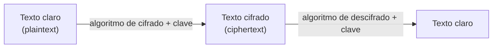

==Idea clave: en la criptografía moderna el **algoritmo puede ser público**; la seguridad depende de **proteger las claves**.==

## 5. Cifrado simétrico

**Misma clave secreta** para cifrar y descifrar. Ambas partes deben tenerla de antemano y protegerla.

| Ventaja | Dificultad |
|---|---|
| Cifra grandes cantidades de datos **eficientemente** | **Distribuir la clave** secreta de forma segura |

**Elementos:** texto claro · algoritmo de cifrado · **clave secreta** (entrada del algoritmo, compartida) · texto cifrado (depende del texto claro y de la clave) · algoritmo de descifrado (entradas: texto cifrado + clave).

### 5.1 Por bloques vs. de flujo

| | **Por bloques** | **De flujo** |
|---|---|---|
| Cómo procesa | El mensaje se divide en **bloques de tamaño fijo** | **Continuamente**, bit a bit o byte a byte, con una secuencia generada a partir de la clave |
| Ejemplo | **AES** (ampliamente usado actualmente) | — |

### 5.2 Modos de operación (cifrado por bloques)

El **modo** influye en la seguridad aunque se use el mismo algoritmo y la misma clave.

| | **ECB** (Electronic Codebook) | **CBC** (Cipher Block Chaining) |
|---|---|---|
| Idea | Cada bloque se cifra **independiente**, misma clave | Cada bloque se **encadena** con el cifrado anterior |
| Bloques iguales de texto claro | Dan bloques iguales de texto cifrado → **se ven los patrones** | Normalmente dan bloques cifrados **distintos** |
| Uso actual | **No adecuado** para info estructurada/repetitiva | Evita el problema de repetición de patrones |

### 5.3 CBC en detalle

- Antes de cifrar cada bloque, se hace **XOR con el bloque cifrado anterior**.
- Para el primer bloque se usa un **Vector de Inicialización (IV)**, c(0) = IV.
- El emisor manda el **IV junto con el mensaje cifrado**. El IV **no es secreto**; la **clave sí**.

| | Fórmula |
|---|---|
| **Cifrado, 1.er bloque** | c(1) = Ks( m(1) ⊕ IV ) |
| **Cifrado, bloque i** | c(i) = Ks( m(i) ⊕ c(i−1) ) |
| **Descifrado, 1.er bloque** | m(1) = D_Ks( c(1) ) ⊕ IV |
| **Descifrado, bloque i** | m(i) = D_Ks( c(i) ) ⊕ c(i−1) |

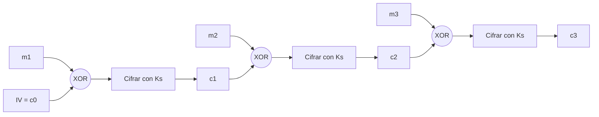

Cada bloque cifrado depende **de su propio contenido y del resultado del bloque anterior**.

### 5.4 Ataques al cifrado simétrico

| Ataque | Idea |
|---|---|
| **Fuerza bruta** | Probar claves sistemáticamente hasta obtener un texto inteligible. Es más difícil cuanto **mayor el tamaño de la clave**, y más fácil cuanto **mayor la capacidad de procesamiento** |
| **Criptoanálisis** | Aprovechar propiedades del algoritmo, patrones del texto o relaciones texto claro/cifrado para deducir la clave o el mensaje |

Un algoritmo seguro debe resistir **ambos**.

### 5.5 Tipos de claves simétricas

| Clave | Característica |
|---|---|
| **De sesión** | Se usa durante **una sesión**; al terminar se descarta. Limita el impacto de una exposición |
| **Permanente** | Dura más tiempo; puede usarse, por ejemplo, para **proteger/distribuir claves de sesión** |

### 5.6 Distribución de claves simétricas

| Alternativa | Idea |
|---|---|
| **Entrega directa** | Una parte genera la clave y la entrega de forma segura a la otra |
| **Tercera parte confiable** | Una entidad confiable genera la clave y la entrega a ambas |
| **Uso de una clave previa** | Una clave ya compartida protege la distribución de una nueva |
| **KDC** | Una tercera parte mantiene relaciones seguras con los usuarios y distribuye dinámicamente claves de sesión |

**KDC (Key Distribution Center):** cada participante tiene una clave **permanente compartida solo con el KDC**. Cuando A y B quieren comunicarse, el KDC interviene para que ambos tengan la **misma clave de sesión**. Ventaja: cada usuario **no necesita una clave permanente con cada uno de los demás** → mejor **escalabilidad**.

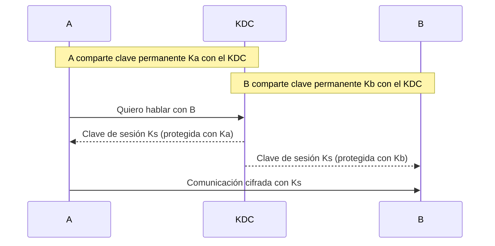

> El slide aclara que existen variantes y que en su esquema la clave de sesión Ks la **genera A** y la distribuye a B mediante el KDC; el diagrama de arriba muestra la idea general de KDC (el esquema exacto del slide es una imagen).

## 6. Cifrado asimétrico

Dos claves distintas, **relacionadas matemáticamente**:

| Clave | Característica |
|---|---|
| **Pública** | Puede ser conocida por cualquiera |
| **Privada** | Secreta, bajo control **exclusivo** de su dueño |

- Lo cifrado con una clave solo se recupera con **la otra clave del mismo par**.
- Evita compartir previamente una clave secreta.
- Cada participante tiene **su propio par** (pública + privada).
- Para que sea seguro: desde la clave pública debe ser **computacionalmente inviable** obtener la privada o recuperar el texto claro sin ella.

### 6.1 Confidencialidad con asimétrico

Alice → Bob: Alice cifra con la **clave pública de Bob**; Bob descifra con **su clave privada**.

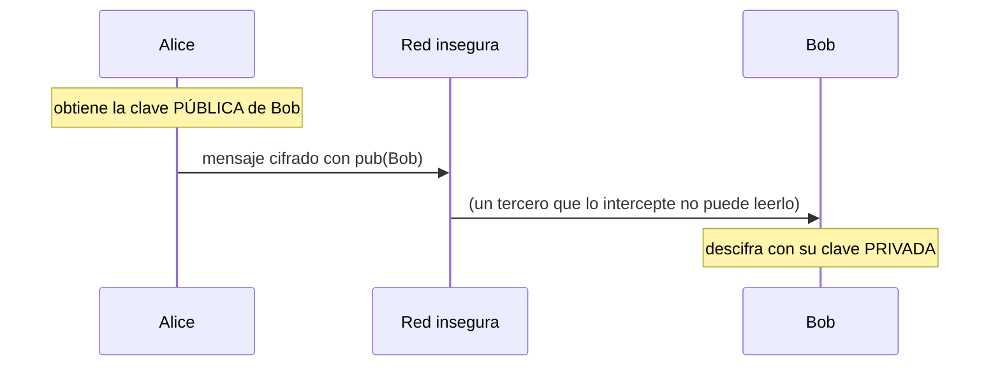

| En la confidencialidad | |
|---|---|
| Clave pública de Bob | **cifra** |
| Clave privada de Bob | **descifra** |

## 7. Integridad y autenticación del origen

El cifrado protege la confidencialidad pero **no resuelve todo**. El receptor puede necesitar:

- **Autenticación del origen:** el mensaje lo generó realmente quien dice ser.
- **Integridad:** el contenido no fue modificado en tránsito.

Mecanismos: **funciones hash**, **MAC**, **firma digital** (no cumplen exactamente la misma función).

### 7.1 Función hash criptográfica

Toma un mensaje **de largo arbitrario** y devuelve un valor **de largo fijo** (hash / resumen / huella): H(m) = h.

Propiedades:

- Desde el hash es **inviable recuperar el mensaje**.
- Es **inviable encontrar dos mensajes distintos con el mismo hash**.
- Un **pequeño cambio** en el mensaje produce un hash **diferente**.

==Idea clave: un hash **no cifra** el mensaje: no hay clave y no sirve para recuperar el texto.==

**¿Alcanza con un hash?** No. Alice manda (m, H(m)); Bob recalcula y compara. Pero un atacante puede **modificar m, calcular un nuevo hash y mandar ambos**. → Hash solo ayuda a verificar **integridad**, pero **no autentica el origen**.

### 7.2 MAC (Message Authentication Code)

Verifica **integridad y autentica el origen** usando un **secreto compartido**.

- Emisor: MAC = MAC_k(m) → envía (m, MAC).
- Receptor (conoce el mismo secreto): recalcula el MAC y compara.
- Si coinciden: el mensaje **no fue modificado** y lo generó **alguien que conoce el secreto**.
- **HMAC:** MAC construido a partir de una **función hash + clave secreta**.

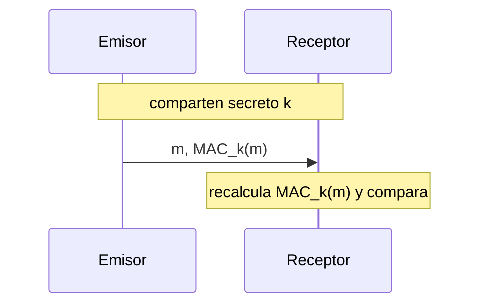

### 7.3 Firma digital

Asocia un mensaje con su emisor, verifica el origen y detecta modificaciones.

- **Firma:** el emisor usa su **clave privada**.
- **Verificación:** el receptor usa la **clave pública del emisor**.

Proporciona:

| Servicio | Detalle |
|---|---|
| **Autenticación del origen** | Quién generó el mensaje |
| **Integridad** | Detecta modificaciones |
| **No repudio** | El emisor no puede negar haber firmado, **siempre que su clave privada haya permanecido bajo su control** |

### 7.4 Firma digital usando hash (en la práctica)

No se firma todo el mensaje: se firma **su hash**.

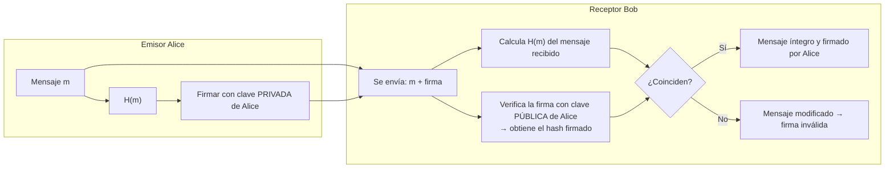

Resumen: **mensaje modificado → hashes diferentes → firma inválida**.

### 7.5 ¿Qué mecanismo usamos para cada objetivo?

| Objetivo | Mecanismo principal |
|---|---|
| **Confidencialidad** | Cifrar con la **clave pública del destinatario**; solo su clave privada lo recupera |
| **Integridad** | **Hash** (si cambia el contenido, cambia la huella). Para que tenga valor de seguridad se combina con **MAC o firma digital** |
| **Autenticación del origen** | **Firma digital**: generada con la clave **privada** del emisor, verificada con su **pública** |
| **No repudio** | **Firma digital**, mientras la clave privada esté bajo control exclusivo del firmante |

Resumen del slide: Confidencialidad → clave pública del destinatario · Autenticación/no repudio → firma con la clave privada del emisor · Integridad → hash + MAC o firma digital.

### Cuadro comparativo

| | Hash solo | MAC | Firma digital |
|---|---|---|---|
| Clave | No | **Secreto compartido** | Par **privada/pública** |
| Integridad | Sí (sin valor de seguridad por sí solo) | Sí | Sí |
| Autenticación del origen | **No** | Sí (quien conoce el secreto) | Sí |
| No repudio | No | — (no se plantea en el slide) | **Sí** |

---

# PARTE B – Gestión de claves públicas, certificados y PKI

## 8. El problema de las claves públicas

Las claves públicas se distribuyen libremente, pero: ¿cómo sabemos que una clave pública **realmente pertenece** a quien dice? Si un atacante **reemplaza** la clave legítima por la suya, puede hacerse pasar por la entidad e **interceptar o modificar** comunicaciones. No alcanza con obtener la clave: hay que **verificar su autenticidad**.

## 9. Certificados digitales

Documento electrónico que **vincula una identidad con una clave pública**, **emitido y firmado** por una **Autoridad de Certificación (CA)**. Contiene, entre otros: identidad del titular, clave pública, período de validez, datos del emisor y **firma digital de la CA**. **No es secreto**: se distribuye públicamente.

### 9.1 CA

- Entidad confiable que **emite y firma** certificados.
- Antes de emitir, **valida la identidad** del solicitante.
- Certificado = **Identidad + Clave pública**, firmado con la **clave privada de la CA**.
- Cualquiera que confíe en la CA verifica la firma con la **clave pública de la CA**.
- La confianza ya no está en la clave del usuario, sino **en la CA** que certifica esa relación.

### 9.2 X.509

Estándar que define la **estructura y formato** de los certificados para que distintos sistemas los interpreten igual. Campos:

| Campo | Qué es |
|---|---|
| Versión | Del formato |
| Número de serie | Identifica al certificado |
| **Emisor (Issuer)** | CA que lo emitió |
| **Período de validez** | Desde/hasta |
| **Sujeto (Subject)** | Identidad dueña del certificado |
| **Clave pública del sujeto** | |
| Algoritmo de firma | |
| **Firma digital de la CA** | |

**X.509 v3** permite **extensiones** (nombres DNS, restricciones de uso, etc.).

## 10. PKI (Infraestructura de Clave Pública)

Conjunto de **componentes, procedimientos y políticas** para gestionar certificados y claves públicas. Permite confiar entre entidades que **no se conocen previamente**.

| Componente | Rol |
|---|---|
| **Entidades finales** | Usuarios, servidores, dispositivos u organizaciones que poseen certificados |
| **CA** | Emiten y firman certificados |
| **RA** (Autoridades de Registro) | Pueden **verificar la identidad** de los solicitantes antes de que la CA emita |
| **Repositorios** | Almacenan y publican certificados e info de **revocación** |
| **Políticas y procedimientos** | Cómo se emiten, usan, renuevan y revocan |

### 10.1 Cadena de confianza

Una entidad no necesita confiar directamente en todas las CA: la confianza se establece por una **cadena de certificados** hasta una **CA raíz confiable**.

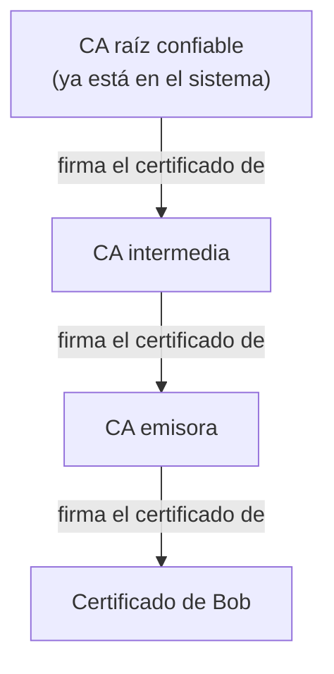

Cómo valida Alice la clave pública de Bob:

1. Obtiene el **certificado de Bob** (firmado por una CA emisora).
2. Para confiar en esa CA, verifica **su** certificado (firmado por una CA intermedia).
3. Sigue verificando certificados hasta llegar a una **CA raíz**.
4. Si la raíz **ya es confiable** para el sistema → la cadena es válida.

`Bob → CA emisora → CA intermedia → CA raíz confiable`

> La cadena **no tiene que llegar a "la raíz absoluta"**: tiene que llegar a **una CA que el sistema ya considere confiable**. La confianza se verifica **hacia arriba**.

### 10.2 Revocación

Un certificado puede dejar de ser confiable **antes de vencer**; la CA lo **revoca**. Causas: compromiso o pérdida de la clave privada, emisión incorrecta, cambio en la condición/autorización del titular.

| | **CRL** (Certificate Revocation List) | **OCSP** (Online Certificate Status Protocol) |
|---|---|---|
| Qué es | **Lista** de certificados revocados publicada **periódicamente** por la CA | **Consulta en línea** del estado de un certificado concreto |
| Identificación | Principalmente por **número de serie** | — |
| Ventaja | — | Evita bajar una lista completa; info **más actualizada** |
| Detalle | El cliente debe consultar una versión **actualizada** antes de confiar | |

---

# PARTE C – TLS

## 11. TLS (Transport Layer Security)

Protocolo que establece una comunicación **segura** entre dos extremos sobre una red insegura. Proporciona:

| Servicio | Cómo |
|---|---|
| **Autenticación** | Identidad del **servidor** mediante **certificados digitales** |
| **Confidencialidad** | **Cifrado** de los datos |
| **Integridad** | Detecta **modificaciones** |

Ejemplo más conocido: **HTTPS = HTTP sobre TLS**.

### 11.1 Criptografía híbrida

| Fase | Qué se usa | Para qué |
|---|---|---|
| **Establecimiento de la conexión** | Certificados + criptografía **asimétrica** | Autenticar al servidor y **establecer de forma segura un secreto compartido** |
| **Transferencia de datos** | Cifrado **simétrico** con claves de sesión | Proteger grandes volúmenes **eficientemente** (confidencialidad e integridad) |

==Idea clave: TLS usa **asimétrica para autenticar y acordar claves**, y **simétrica para proteger los datos**.==

### 11.2 Handshake TLS

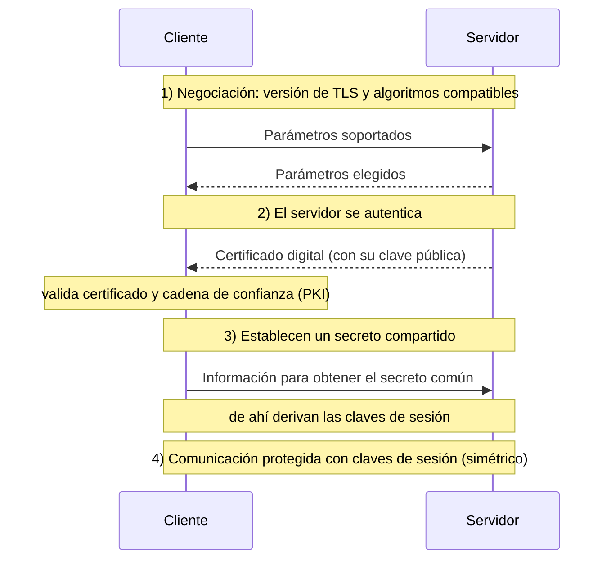

Resumen: **Negociación → Autenticación → Establecimiento de claves → Canal seguro**.

---

# PARTE D – VPN e IPsec

## 12. VPN

**Red Privada Virtual:** extiende una red privada usando una **red pública** (Internet) para transportar el tráfico. Usuarios o redes geográficamente separados se comunican **como si estuvieran en la misma infraestructura privada**.

Protege el tráfico con: **confidencialidad** (cifrado), **integridad** (detección de modificaciones) y **autenticación** (de los extremos).

Conecta, por ejemplo: **sucursal ↔ oficina central**, **usuario remoto ↔ red de la organización**, **dos redes privadas** separadas.

## 13. IPsec

Conjunto de mecanismos para proteger comunicaciones **directamente en la capa IP**. Se usa entre **host–host**, **host–router** o **router–router**.

Puede dar:

| Servicio | Detalle |
|---|---|
| **Confidencialidad** | Cifra el contenido de los datagramas |
| **Integridad** | Detecta modificaciones |
| **Autenticación del origen** | Verifica quién generó el tráfico |
| **Protección contra replay** | Usa **números de secuencia** para detectar datagramas repetidos |

Al operar en la capa IP protege tráfico de **cualquier protocolo superior** (TCP, UDP, ICMP, HTTP, SMTP…): protege **paquetes IP independientemente de la aplicación**.

### 13.1 Modos: transporte vs. túnel

| | **Transporte** | **Túnel** |
|---|---|---|
| Qué protege | La **carga útil** del paquete IP | El **paquete IP original completo** (con su cabecera) |
| Cabecera IP | La **original queda visible** (para el encaminamiento) | Se **encapsula** en un **nuevo paquete IP** con **nueva cabecera externa** visible |
| Escenario típico | **Host a host** (los extremos implementan IPsec) | **VPN sitio a sitio**: routers/gateways arman el túnel y los equipos internos **no necesitan IPsec** |

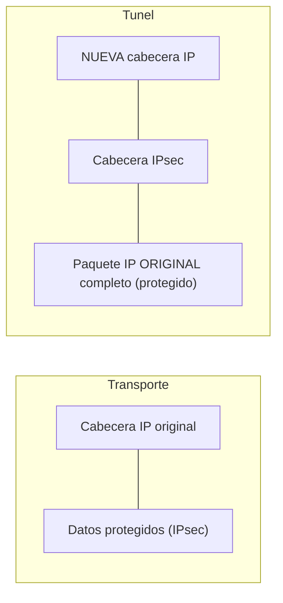

### 13.2 Protocolos AH y ESP

> **AH y ESP = mecanismos de protección. Transporte y túnel = modos de funcionamiento.**

| | **AH** (Authentication Header) | **ESP** (Encapsulating Security Payload) |
|---|---|---|
| Da | **Autenticación + integridad** (y ayuda contra repetición) | **Confidencialidad** + autenticación, integridad y protección contra repetición |
| ¿Cifra los datos? | **No** (el contenido sigue visible) | **Sí** |
| Cuándo | Se necesita autenticidad e integridad (incluso de partes de la cabecera IP), **sin confidencialidad** | Se quiere además **ocultar** el contenido |
| Uso actual | — | **El más usado** en IPsec y VPN modernas |

Combinaciones:

| Combinación | Qué pasa |
|---|---|
| **AH – transporte** | Cabecera IP original visible; integridad y autenticación, **sin cifrado** |
| **AH – túnel** | Nueva cabecera IP + paquete original encapsulado; integridad y autenticidad, **sin confidencialidad** |
| **ESP – transporte** | Cabecera IP original visible; **carga útil protegida** (puede viajar cifrada) con integridad y autenticación |
| **ESP – túnel** | **Paquete original completo encapsulado y protegido**; nueva cabecera IP externa visible. **La más usada en VPN IPsec site-to-site** |

### 13.3 Asociación de Seguridad (SA)

Antes de mandar tráfico protegido, los extremos acuerdan **cómo** protegerlo. Ese conjunto de parámetros es una **SA**:

- Relación lógica **unidireccional** entre dos entidades IPsec.
- Puede incluir: **SPI** (Security Parameter Index, identifica la SA), direcciones origen/destino, algoritmo y **clave de cifrado**, mecanismo y clave de **integridad/autenticación**.
- Como es **unidireccional**, para comunicación protegida en ambos sentidos se necesitan **dos SA** (una por sentido).

### 13.4 Datagrama IPsec con ESP en modo túnel

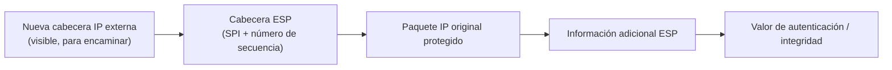

| Parte | Función |
|---|---|
| **Nueva cabecera IP externa** | Encaminar entre los extremos del túnel (debe ser visible) |
| **Cabecera ESP** | Incluye **SPI** y **número de secuencia** |
| **Paquete IP original protegido** | El datagrama original, dentro del túnel |
| **Info adicional ESP** | Para completar el procesamiento |
| **Autenticación/integridad** | Cuando corresponde |

### 13.5 Procesamiento de un paquete ESP recibido

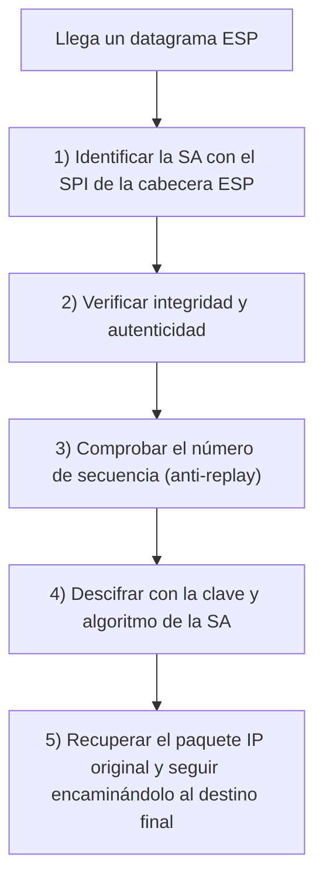

Así el receptor verifica que el paquete pertenece a una comunicación válida, **no fue alterado ni repetido** y recupera el datagrama original.

### 13.6 IKE – gestión de claves en IPsec

**IKE (Internet Key Exchange):** negocia **automáticamente** los parámetros para comunicarse de forma segura. Antes de transmitir, los extremos deben:

- **autenticarse** entre sí,
- **acordar** los algoritmos criptográficos,
- **establecer de forma segura** el material criptográfico para obtener las claves,
- **crear las SA**.

==Idea clave: **IKE negocia y establece** la seguridad; **ESP usa** esos parámetros para proteger los paquetes.==

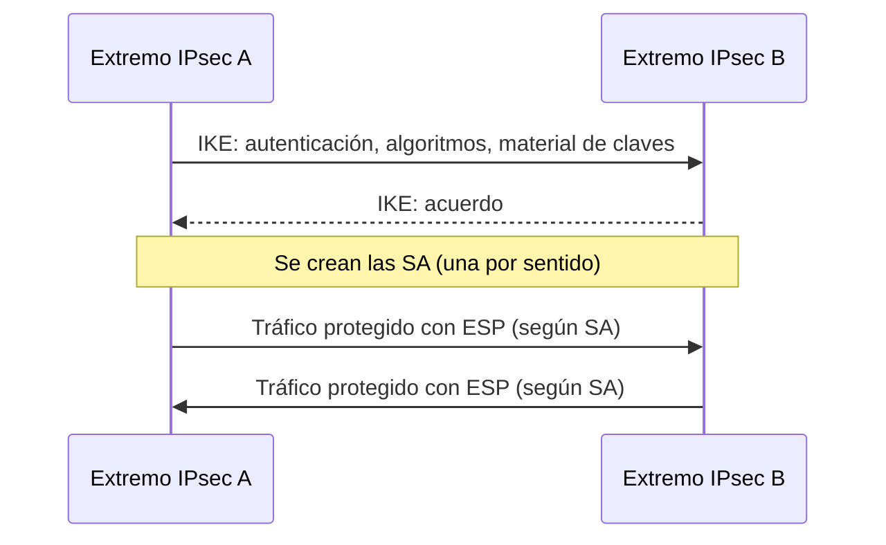

## 14. Síntesis de la unidad

| Objetivo | Mecanismos |
|---|---|
| **Confidencialidad** | Cifrado simétrico, asimétrico, TLS, ESP |
| **Integridad** | Hash como base; MAC, firma digital, TLS e IPsec para protección verificable |
| **Autenticación** | MAC, firma digital, certificados, TLS, IKE/IPsec |
| **No repudio** | Firma digital |
| **Gestión de confianza** | Certificados, CA, PKI |
| **Protección de comunicaciones** | TLS, VPN, IPsec |

La seguridad efectiva surge de **combinar** correctamente estos mecanismos.

---

# Ejercicios de práctica (tipo parcial) – con solución

**1.** Alice quiere mandarle un mensaje confidencial a Bob usando criptografía asimétrica. ¿Qué clave usa cada uno?
→ Alice cifra con la **clave pública de Bob**; Bob descifra con **su clave privada**.

**2.** Alice quiere que Bob pueda verificar que el mensaje es de ella y no fue alterado. ¿Qué hace?
→ Calcula **H(m)**, lo **firma con su clave privada** y envía m + firma. Bob calcula H(m), **verifica la firma con la clave pública de Alice** y compara los dos hashes.

**3.** Un atacante intercepta (m, H(m)), cambia m por m' y calcula H(m'). ¿Bob lo detecta? ¿Y con MAC?
→ Con hash solo: **no**, los valores son consistentes. Con **MAC (o HMAC)**: el atacante no conoce el secreto compartido, no puede generar un MAC válido para m' → Bob lo detecta.

**4.** ¿Por qué CBC es mejor que ECB? ¿El IV es secreto?
→ En ECB bloques iguales dan cifrados iguales (se ven patrones); CBC hace XOR con el bloque cifrado anterior, así bloques iguales dan cifrados distintos. El **IV no es secreto** y se manda con el mensaje; la clave sí es secreta.

**5.** Dos bloques de texto claro iguales en CBC, ¿dan el mismo cifrado?
→ Normalmente **no**, porque cada uno se combina con un bloque cifrado anterior distinto.

**6.** Explicá cómo valida un navegador el certificado de un sitio.
→ Obtiene el certificado del servidor, verifica la firma de la CA emisora; sube verificando certificados (intermedias) hasta una **CA raíz que el sistema ya considera confiable**; además verifica el período de validez y que no esté revocado (CRL/OCSP).

**7.** Diferencia entre CRL y OCSP.
→ CRL: lista periódica de revocados (por número de serie) que el cliente debe tener actualizada. OCSP: consulta en línea del estado de un certificado concreto, sin bajar la lista, más actualizada.

**8.** ¿Por qué TLS combina asimétrica y simétrica?
→ Asimétrica para **autenticar al servidor y acordar un secreto** (sin secreto previo); simétrica para los datos porque es **mucho más eficiente** con grandes volúmenes. Del secreto se derivan las **claves de sesión**.

**9.** Dos sucursales quieren una VPN sitio a sitio con confidencialidad. ¿Qué protocolo y modo de IPsec?
→ **ESP en modo túnel** (la combinación más usada). Los hosts internos no necesitan IPsec; los routers/gateways arman el túnel.

**10.** ¿Cuántas SA hacen falta para comunicación protegida en ambos sentidos? ¿Qué las identifica?
→ **Dos** (son unidireccionales). Las identifica el **SPI** (junto con los otros parámetros).

**11.** El receptor recibe un paquete ESP. ¿Qué pasos sigue?
→ 1) Identifica la SA por el SPI; 2) verifica integridad/autenticidad; 3) comprueba el número de secuencia (replay); 4) descifra; 5) recupera el paquete original y lo encamina.

**12.** ¿Qué diferencia hay entre AH y ESP? ¿Y entre transporte y túnel?
→ AH: autenticación e integridad, **sin cifrar**. ESP: además **cifra**. Transporte: protege la carga útil, cabecera IP original visible. Túnel: encapsula el paquete original completo en un nuevo paquete IP. (AH/ESP = mecanismos; transporte/túnel = modos.)

---

# Verdadero o Falso (rápido)

| # | Afirmación | Resp. |
|---|---|---|
| 1 | Un ataque pasivo modifica los datos en tránsito. | **F** (solo observa) |
| 2 | El análisis de tráfico es posible aunque el contenido esté cifrado. | **V** |
| 3 | En criptografía moderna el algoritmo debe mantenerse secreto. | **F** (puede ser público; lo que se protege es la clave) |
| 4 | En el cifrado simétrico la principal dificultad es distribuir la clave. | **V** |
| 5 | ECB cifra cada bloque de forma independiente. | **V** |
| 6 | En CBC el IV debe mantenerse secreto. | **F** |
| 7 | Un hash permite recuperar el mensaje original. | **F** |
| 8 | Hash solo garantiza autenticación del origen. | **F** |
| 9 | Un MAC requiere un secreto compartido. | **V** |
| 10 | La firma digital se genera con la clave pública del emisor. | **F** (con la **privada**; se verifica con la pública) |
| 11 | El certificado digital es secreto. | **F** |
| 12 | Una CA firma el certificado con su clave privada. | **V** |
| 13 | La cadena de confianza debe llegar a "la raíz absoluta". | **F** (a una CA que el sistema ya considere confiable) |
| 14 | OCSP evita descargar una lista completa de revocados. | **V** |
| 15 | TLS usa solo criptografía asimétrica. | **F** (híbrida) |
| 16 | AH cifra los datos. | **F** |
| 17 | ESP en modo túnel es muy usada en VPN site-to-site. | **V** |
| 18 | Una SA es bidireccional. | **F** (unidireccional → dos SA) |
| 19 | IKE protege los datos de usuario con cifrado. | **F** (negocia y establece SA/claves; ESP protege los paquetes) |
| 20 | En modo transporte la cabecera IP original permanece visible. | **V** |
